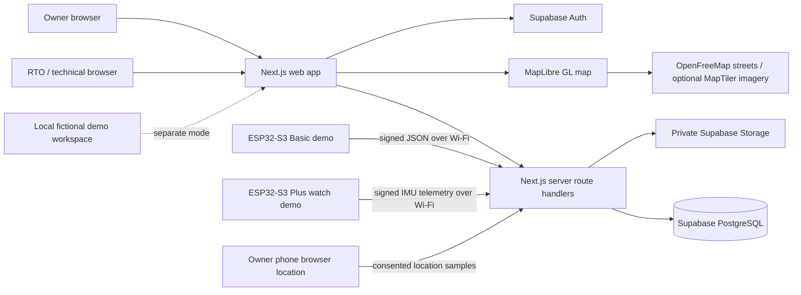

# VahakIN

**Declared Non Use. Verified Compliance.**

VahakIN is a vehicle monitoring and regulatory decision-support prototype for
vehicles whose owners have declared them **Non-Use**. It is being developed for
SFIC 2026 Problem `PS000225` (Collector Office – Rajkot; CSPIT, CHARUSAT
University, `TM002281`).

The prototype connects a vehicle-owner application, an RTO review workspace,
ESP32-based hardware demonstrations, and a Supabase-backed pilot workflow. Its
purpose is to help authorised reviewers examine device and location observations
alongside an application and its supporting documents.

> [!IMPORTANT]
> This repository is a prototype, not an approved government deployment. It is
> not an official VAHAN integration, legal decision system, tax collection
> service, or certified vehicle tracker. GPS, IMU, phone-location and demo
> events are observations for human review; they do not establish a legal
> violation. Use fictional records for demonstrations and never put real owner
> information, device credentials or service-role keys in Git.

## Contents

- [Project status and scope](#project-status-and-scope)
- [What is implemented](#what-is-implemented)
- [Architecture](#architecture)
- [User journeys](#user-journeys)
- [Hardware](#hardware)
- [Software stack](#software-stack)
- [Repository map](#repository-map)
- [Run the web application](#run-the-web-application)
- [Configuration and security](#configuration-and-security)
- [Device provisioning and hardware demos](#device-provisioning-and-hardware-demos)
- [Tests and quality checks](#tests-and-quality-checks)
- [Data model and migrations](#data-model-and-migrations)
- [Known limitations and next engineering work](#known-limitations-and-next-engineering-work)
- [Project documentation](#project-documentation)

## Project status and scope

The codebase contains a working Next.js application and a limited Supabase
pilot, plus broader architecture specifications for a future service. Keep
these maturity levels distinct:

| Area | Current repository state |
|---|---|
| Web application | Implemented in `apps/web`: public landing page, authentication screens, owner onboarding, role-aware workspaces, map, and API route handlers. |
| Live identity and onboarding | Uses Supabase Auth and a live Supabase database for confirmed accounts, the Rajkot owner-application flow, private application documents, provisioned devices, hardware telemetry and owner-shared phone locations. |
| Demonstration workspace | Credential-gated, fictional records in an ignored local JSON store. Demo state is not production persistence and is separate from the live Supabase workspace. |
| Backend API | `services/api` describes the intended FastAPI modular-monolith design, but currently contains a dependency manifest, documentation and placeholder directories—not a running API implementation. |
| Database | `supabase/migrations/` contains the current Supabase pilot schema and RPCs. `database/migrations/0010_tax_compliance.sql` is a separate, unapplied schema blueprint that depends on a larger foundational schema. |
| Firmware | Two Arduino/ESP32-S3 demonstration sketches and supporting hardware tests are present. The sketches have not been flashed or validated on the physical assemblies. |
| ML, deployment and shared API contracts | Planned/scaffolded areas. No trained model, production deployment configuration or shared telemetry JSON Schema is currently implemented. |

This distinction matters: some `docs/spec/` documents describe the intended
system, not a feature that exists today. The present live pilot is limited to
Rajkot city / GJ-03 and is not suitable for unattended or regulatory use.

## What is implemented

### Web experience

- Public product landing page with responsive layout, theme support and reduced
  motion handling.
- Separate owner and government sign-in entry points backed by the same
  application identity system.
- Role-aware government (`/gov`), owner (`/owner`) and technical (`/ops`)
  workspaces, with shared dashboards, tables, map, alerts and workflows.
- A six-step owner application: device claim, applicant, vehicle/tax details,
  parking and dates, documents, and final review.
- Office review actions for beginning a review, requesting corrections,
  rejecting with a reason, or approving after required review checks.
- Application revisions and action history, optimistic version checks, and
  private document uploads/downloads.
- Vehicle monitoring views for status, device health, alerts, parking
  geofences, and location source.
- Device simulator and operational workflows in the fictional demo workspace.
- Tax/compliance investigation and reporting workflows in DEMO mode only.

### Live pilot capabilities

The live Supabase path is narrower than the product specifications:

- Confirmed Supabase Auth accounts and server-side role resolution.
- Owner application drafts, submissions, office review and approval.
- Private application document storage in the `vahakin-documents` bucket.
- Server-provisioned devices with separate owner activation codes and device
  signing secrets.
- Signed setup heartbeat and signed Basic/Plus telemetry endpoints.
- Owner-consented browser location sharing for an approved, mounted Plus
  device.
- Server-side, version-checked database writes and scoped workspace reads.

Live financial/tax processing intentionally fails closed. Official government
records, official filings, VAHAN, payments, external notifications and a
production FastAPI service are not connected.

## Architecture

### Current runtime



The Next.js server is currently the application backend for implemented
workflows. It checks the signed-in user and permissions, validates requests,
then accesses Supabase using server-only credentials and narrow database RPCs.
The browser does not receive the service-role key. Live workspace changes use
versioned snapshots and commits to detect concurrent updates.

The DEMO path uses a shared local JSON file under `apps/web/.data/`, protected
by a local transaction lock and atomic file replacement. It can simulate
accounts, devices, events and workflows, but it is not PostgreSQL, is not
Supabase RLS, and is not suitable for multiple production instances.

### Proposed future architecture

The specifications propose a Python FastAPI modular monolith, PostgreSQL +
PostGIS, a durable database outbox/worker, typed shared telemetry contracts,
and authorised integrations. Those are design targets, not the current runtime.
In particular, the planned `/api/v1/device/events` contract is not the same as
the implemented demonstration endpoint `/api/devices/telemetry`.

### Current data flow

1. A human signs in through Supabase Auth (or uses the separately enabled
   local DEMO identity).
2. The Next.js server resolves the profile, role and scope, and serves the
   appropriate owner, government or technical workspace.
3. An owner submits an application. Submitted revisions and uploaded documents
   are associated with the application and routed to the configured office.
4. An RTO reviewer checks the package and records an independent decision.
   Approval creates the vehicle/device relationship; it does not by itself
   mean installation or monitoring has been verified.
5. A provisioned device sends signed observations, or an owner explicitly
   shares browser location for a compatible Plus device.
6. Server checks authenticate and validate the event, preserve it, update the
   permitted workspace state and may create a review alert.
7. Reviewers see observations with their timestamps and source and decide what
   follow-up is appropriate. No automatic penalty or legal finding is produced.

### Access roles

The application defines these role identifiers: `national_admin`,
`state_admin`, `rto_admin`, `rto_manager`, `enforcement_officer`,
`registration_operator`, `device_technician`, `auditor`, `vehicle_owner`, and
`technical_admin`.

Permissions and jurisdiction are enforced on the server as well as reflected
in workspace navigation. Owners are scoped to their verified records; office
staff are scoped to their office; state and national workspaces use the
configured hierarchy. Technical roles do not automatically receive owner
details or tax capabilities. The live pilot assigns government roles from
verified staff grants, not from a public role picker.

## User journeys

### Owner onboarding and RTO review

1. The owner creates an account at `/login/owner` and confirms the email address.
2. A new owner without a verified vehicle is directed to `/owner/onboarding`.
3. The owner enters a provisioned device ID and activation code. Claiming
   reserves the device; it is not proof of installation.
4. The owner completes the six application steps and uploads the required
   supporting files. Requirements vary according to vehicle category,
   applicant capacity and reason for Non-Use.
5. On submission, the server validates the package and routes Rajkot-city
   applications to GJ-03. The application is still pending review and is not
   yet a verified vehicle registration.
6. An authorised RTO reviewer examines the submitted revision and documents,
   then starts review, requests corrections, rejects with a reason, or approves
   after confirming identity, ownership/authority, documents and jurisdiction.
7. Approval creates linked owner, vehicle and device records. The owner confirms
   dashboard mounting separately; an authorised reviewer verifies installation
   after a recent device connection.
8. Monitoring remains a separate status from application approval,
   installation, declaration status and any tax determination.

### Hardware observation and alert review

1. A provisioned device samples its IMU and, on Basic hardware, its GNSS module.
   Plus hardware reports IMU telemetry; its watch firmware does not provide GPS.
2. The device signs the exact JSON request body with its per-device HMAC-SHA256
   secret and sends it to the Next.js telemetry route.
3. The server checks the device identity, timestamp, nonce, schema, firmware
   tier and signature before accepting a packet.
4. A possible movement or geofence alert is described as demonstration
   evidence and requires human review. Device handling can also produce IMU
   movement; IMU motion alone cannot prove vehicle travel.
5. A Plus owner may separately consent to share location from a phone browser
   while the phone is beside the mounted watch. The page must remain open and
   location permission must be granted.
6. Reviewers examine the source-labelled location and alert. A missing heartbeat
   or GPS fix is shown as unavailable/stale, not as evidence of a violation.

### Tax/compliance DEMO journey

The local demo includes an illustrative investigation and financial workflow:
evidence review, a synthetic rule calculation, owner response, independent
review, simulated decision, notice draft, receipt reconciliation and appeal
reference. It uses clearly labelled demo records/rates and does not connect to
government issuance or a payment gateway. The `/api/tax` route denies live
accounts until verified rules and authority configuration exist.

## Hardware

### Demonstration hardware

| Device variant | Hardware in the repository | Data path | Important boundary |
|---|---|---|---|
| **Basic** | ESP32-S3 development board, GY-521 / MPU-6050 IMU, NEO-6M GNSS receiver | Wi-Fi hotspot to the web app; GNSS positions originate on the device | No cellular transport in the current sketch. SIM800L is not used by this demo. |
| **Plus** | Waveshare ESP32-S3-Touch-AMOLED-2.06 watch board with onboard QMI8658 IMU | Wi-Fi hotspot to the web app; location is shared separately from the owner's phone browser | No GPS module is initialized by the Plus sketch. The phone's position is not watch GPS. |

The project team also owns a SIM800L 2G modem, but it is a hardware bring-up
and compatibility experiment, not part of either currently described
end-to-end sketch. Its power requirements and secure transport capability must
be validated before any use. Do not send sensitive telemetry over insecure
cellular HTTP. A future 4G/GNSS design is a separate engineering decision.

### Demonstration sensing and thresholds

- The shared firmware runtime samples the IMU at 50 Hz. Five seconds of
  sufficiently still readings are required for calibration.
- The illustrative movement detector uses a rolling two-second window. At
  least 1.5 seconds above either 0.12 g dynamic acceleration or 12 degrees/sec
  rotation qualifies as device movement; five quiet seconds re-arm detection.
- These values are starting points for a demonstration, not validated
  automotive thresholds. Movement may be caused by handling or mounting and is
  not proof that the vehicle moved.
- Basic validates NMEA checksums and matches RMC/GGA timestamps before accepting
  a GPS fix. Server geofence evaluation requires fresh fixes, at least five
  satellites, HDOP at or below 2.5, two observations 3–30 seconds apart, and a
  25 m boundary buffer.
- Plus location comes from an owner phone browser. Samples must be fresh (up to
  15 seconds old), report accuracy no worse than 30 m, and are evaluated with
  an uncertainty buffer. A watch heartbeat is still required before a phone
  sample can contribute to the demonstration geofence alert.
- Both variants use a bounded queue of up to eight unacknowledged movement
  events. The queue is a prototype, not a long-term evidence archive; overflow
  is counted in serial diagnostics.
- The map can display street tiles and parking circles. Satellite/hybrid imagery
  requires a configured MapTiler key. The tilted view is a 2.5D perspective
  with building extrusion only where the selected style supplies building
  data; it is not a full 3D city model or satellite video.

### Electrical and deployment safety

Exact ESP32-S3, MPU6050 and SIM800L board variants, regulators, connectors and
power rails must be identified before wiring. A bare SIM800L VBAT is not a 5 V
input and may require approximately 2 A transmit peaks. Do not power an
unverified assembly from the ESP32 regulator, breadboard rails or an
unvalidated battery/charger combination. No complete assembled unit has been
electrically qualified for unattended vehicle installation. See the [hardware
specification](docs/spec/harware.md) for the inspection checklist, power
architecture, BOM assumptions and bring-up gates.

## Software stack

### Implemented web application

| Layer | Technology |
|---|---|
| Web framework | Next.js 15 App Router, React 19 |
| Language/type checking | TypeScript 5 |
| UI styling | Tailwind CSS 4, local CSS token and layout styles |
| UI components | Radix primitives, project-local components and Lucide icons |
| Forms and validation | React Hook Form, Zod, `@hookform/resolvers` |
| Authentication and persistence | Supabase Auth, `@supabase/ssr`, Supabase JS/PostgreSQL |
| Mapping | MapLibre GL JS; OpenFreeMap streets; optional MapTiler satellite/hybrid |
| Charts and animation | Recharts, Framer Motion / Motion, GSAP |
| Unit tests | Vitest, Testing Library, jsdom |
| Browser tests | Playwright |

The Next app contains public pages, `/login/owner`, `/login/government`,
`/auth/callback`, password reset, `/demo`, `/owner/onboarding` and shared
catch-all workspaces under `/gov`, `/owner` and `/ops`. Most dashboard sections
are rendered by the common `WorkspacePage` / `Dashboard` components according
to the authenticated role and selected section.

### Planned or scaffolded backend

`services/api/pyproject.toml` declares Python `>=3.12`, FastAPI, Pydantic
settings, Psycopg 3, HTTPX, PyJWT, Supabase and ReportLab, with pytest and Ruff
development extras. The package describes the intended versioned API and
outbox-worker structure, but there is currently no `app/main.py`, API router,
domain implementation or worker to run.

The `packages/contracts`, `packages/api-client`, `ml/` and `infra/` areas are
placeholders or planning artifacts. The architecture and implementation
specifications describe desired future responsibilities; they are not evidence
that these components are deployed.

## Repository map

```text
.
├── apps/
│   └── web/                   # Implemented Next.js application
│       ├── app/               # Public pages, portals, auth and API routes
│       ├── components/        # Dashboard, map, onboarding, home and UI
│       ├── lib/               # Auth, permissions, workspace, telemetry,
│       │                      # enrollment, phone location and tax services
│       ├── scripts/           # Device provisioning and local map assets
│       ├── styles/            # Design tokens and page-specific styles
│       └── tests/             # Vitest unit + Playwright end-to-end coverage
├── database/
│   ├── migrations/            # Unapplied tax-compliance migration blueprint
│   └── README.md              # Target logical schema and migration ordering
├── docs/
│   ├── spec/                  # Product, architecture, DB, hardware and plan
│   └── implementation/        # Owner onboarding and tax workflow notes
├── firmware/
│   ├── hotspot_imu_demo/      # Basic ESP32-S3 + MPU6050 + NEO-6M demo
│   ├── plus_watch_demo/       # ESP32-S3/QMI8658 + phone location demo
│   ├── hw_test/               # Serial, sensor and SIM800L experiments
│   ├── libraries/VahakinDemo/ # Shared detector and transport implementation
│   └── tests/                 # Host motion detector and NMEA checks
├── infra/                     # Placeholder deployment/monitoring folders
├── ml/                        # Placeholder ML and dataset folders
├── packages/                  # Planned shared contracts/client
├── services/api/              # FastAPI target scaffold, not runtime backend
├── supabase/
│   ├── migrations/            # Applied/current pilot schema changes
│   ├── config.jsonc            # Supabase Auth redirect configuration
│   └── SETUP.txt               # Maintainer/live setup notes
└── tools/                     # Local provisioning/network/HTTPS helpers
```

The tree also contains `.gitkeep` files to preserve planned module folders.
Those are placeholders, not implementations. `apps/web/public/images/` holds
the landing-page imagery and other assets.

### Important web endpoints

| Endpoint | Purpose |
|---|---|
| `POST /api/session` | Demo session actions and Supabase owner sign-up/sign-in/recovery. |
| `GET/POST /api/applications` | Read a scoped application workspace and perform application lifecycle actions. |
| `POST /api/applications/documents` | Validate and upload private application documents. |
| `GET /api/applications/documents/:id` | Authorised attachment-only document download. |
| `POST /api/devices/heartbeat` | Signed device setup connection check; not GPS or compliance evidence. |
| `POST /api/devices/telemetry` | Signed Basic/Plus hardware demonstration telemetry. |
| `POST /api/devices/phone-location` | Owner-consented phone location samples for Plus demonstration devices. |
| `GET/POST /api/workspace` | Scoped workspace reads, exports and dashboard actions. |
| `GET/POST /api/tax` | DEMO-only tax workflow; live accounts are rejected. |
| `GET /api/tax/documents/:id` | Scoped DEMO tax document download. |
| `GET /auth/callback` | Supabase email-confirmation and password-recovery callback. |

## Run the web application

### Prerequisites

- Node.js and npm versions supported by the checked-in Next.js version.
- A Supabase project for live sign-up/onboarding and device flows.
- Supabase environment settings (see below). DEMO mode additionally requires
  its explicit local credential configuration.
- Optional: Arduino CLI and the ESP32 Arduino core for firmware compilation.

### Install and start

From the repository root:

```bash
cd apps/web
npm ci
cp ../../.env.example .env.local
```

Edit `apps/web/.env.local` and provide valid values for the settings required by
the mode you intend to run. The checked-in `.env.example` contains placeholders,
not working credentials. Start the development server from `apps/web`:

```bash
npm run dev
```

Open [http://localhost:3000](http://localhost:3000). The `predev` hook prepares
the local MapLibre worker asset before Next.js starts. The application has no
root-level development script; install and run its npm commands from
`apps/web`.

### Supabase setup

The current Supabase schema and Auth callback configuration are in
`supabase/migrations/` and `supabase/config.jsonc`. The migration set is
specific to this prototype. Apply it only to a development project you control
after reviewing the SQL and verifying the target project. Configure Auth email
confirmation, the correct site URL and redirect/callback URLs for the host.
Production email delivery and deployment callback configuration have not been
verified.

`supabase/SETUP.txt` documents the current maintainer setup and live pilot
workflow. `tools/configure-supabase-env.py` can prepare an ignored local env
file for the maintainer's linked Supabase project; it requires an authenticated
Supabase CLI and writes server credentials. Treat it as a maintainer-specific
helper, not as a generic project provisioning script. Never print, commit or
send the resulting `SUPABASE_SERVICE_ROLE_KEY`.

### Demo mode

The fictional local demo workspace is enabled only when the demo email and
password-hash variables are configured (or while running tests). Its shared
records and sessions are saved under `apps/web/.data/`, which is ignored by
Git. Demo identity switching is a presentation/testing feature, not real
authentication, and should never be enabled on an installation containing real
owner data.

The demo workspace includes fictional accounts representing national/state
administration, RTO administration and management, enforcement, registration,
device technical staff, audit, vehicle ownership and technical administration.
Do not treat demo personas, seeded records, maps or simulated telemetry as
official.

## Configuration and security

`.env.example` documents the broader project configuration. For the current
Next.js app, the main settings are:

| Variable | Use | Exposure |
|---|---|---|
| `NEXT_PUBLIC_SUPABASE_URL` | Supabase project URL | Browser-visible |
| `NEXT_PUBLIC_SUPABASE_PUBLISHABLE_KEY` | Supabase publishable client key | Browser-visible; database policies still apply |
| `SUPABASE_SERVICE_ROLE_KEY` | Server-side Supabase operations | Secret; never use a `NEXT_PUBLIC_` prefix |
| `VAHAKIN_DEMO_EMAIL` | Explicit local DEMO sign-in identity | Local configuration |
| `VAHAKIN_DEMO_PASSWORD_SHA256` | SHA-256 digest used by the local demo login | Local configuration; never put the password in source |
| `NEXT_PUBLIC_MAPTILER_KEY` | Optional satellite/hybrid tiles | Browser-visible; restrict at the provider |
| `NEXT_PUBLIC_API_BASE_URL`, `DATABASE_URL`, `SUPABASE_URL`, `DEVICE_SECRET_MASTER_KEY_REF`, `ALLOWED_ORIGINS`, `REPORT_BUCKET`, `NOTIFICATION_MODE` | Documented target backend settings; some are for the unimplemented FastAPI service | Server-only where applicable |

Never put database passwords, service-role credentials, device HMAC secrets,
hotspot passwords or private keys in browser-visible variables, tracked
configuration, screenshots or logs. Local `.env*`, provisioning output,
firmware `config.local.h`, certificates and demo data are excluded by
`.gitignore`.

Implemented protections include same-origin checks for browser mutations,
server-side role/scope checks, bounded request bodies, schema validation,
rate-limited login/device actions, private object storage, hashed activation
codes, HMAC-signed device telemetry, nonce replay checks and optimistic
workspace versioning. These controls are prototype measures, not a completed
security certification or production threat-model review.

For the Basic/Plus local hotspot demonstration, HTTP is restricted by firmware
to a private IPv4 LAN. Local HTTP does not encrypt telemetry; use only with
non-sensitive demo data on a trusted private network. Use a configured,
trusted HTTPS certificate for any deployment/network where confidentiality is
required. The phone-location flow needs HTTPS (a browser secure context) when
accessed from a phone; see the Plus firmware guide.

## Device provisioning and hardware demos

### Compile a sketch (do not flash without hardware authorization)

The sketches target the ESP32-S3 Arduino core and include the shared library
from `firmware/libraries`. From the repository root:

```bash
arduino-cli compile \
  --fqbn esp32:esp32:esp32s3 \
  --libraries firmware/libraries \
  firmware/hotspot_imu_demo

arduino-cli compile \
  --fqbn esp32:esp32:esp32s3 \
  --libraries firmware/libraries \
  firmware/plus_watch_demo
```

The Plus guide records ESP32 Arduino core 2.0.17 as the version used for its
compile validation. Neither demonstration has been flashed or verified on its
physical board. Compilation is not a substitute for electrical inspection,
sensor calibration, secure mounting or supervised bring-up.

### Private device provisioning

From `apps/web`, with a correctly configured `.env.local`, an administrator can
provision a unique device with:

```bash
node --env-file=.env.local scripts/provision-device.mjs IG-DEVICE-ID SERIAL-NUMBER
```

The script generates a random activation code and a separate random telemetry
secret. It stores both in an ignored, permission-restricted file under
`apps/web/.provisioned/`, stores only the activation-code hash in inventory,
and saves the device secret server-side. Give the owner only the activation
code; install the telemetry secret into the device configuration securely.
Do not reuse credentials between devices.

The fixed Basic and Plus presentation units have a separate idempotent helper:

```bash
node --env-file=.env.local scripts/provision-hotspot-demo.mjs basic
node --env-file=.env.local scripts/provision-hotspot-demo.mjs plus
```

These are maintainer demo fixtures; the script refuses mismatched existing
credentials and does not reassign an already provisioned device.

### Hotspot network and HTTPS

For local hardware connectivity, join the laptop and device to the same 2.4 GHz
phone hotspot. Update the local firmware endpoint after the laptop joins:

```bash
python3 tools/configure-hotspot-endpoint.py --device basic --port 3000
# Or: --device plus
```

The helper writes an ignored `config.local.h` and accepts only a private LAN
IPv4 address. Recompile after changing the endpoint. The device cannot use
`localhost` to reach the laptop.

For phone browser geolocation from the Plus flow, use trusted local HTTPS. The
guide at `firmware/plus_watch_demo/README.md` documents
`python3 tools/prepare-phone-https.py`, how to trust only the generated demo CA
on the phone, and how to start a separate HTTPS Next.js server. Keep all private
keys on the laptop, remove the demo CA when finished, and do not expose these
development servers publicly.

### Hardware guides and bench tests

- [Basic hotspot IMU/GNSS guide](firmware/hotspot_imu_demo/README.md)
- [Plus watch and phone-location guide](firmware/plus_watch_demo/README.md)
- `firmware/hw_test/`: ESP32, serial bridge, SIM800L, SMS and modem diagnostics.
  These are experiments, not production components.
- `firmware/tests/motion_detector_test.cpp`: host-side motion-detector test.
- `firmware/tests/nmea_test.py`: NMEA parser test.

## Tests and quality checks

Run web checks from `apps/web`:

```bash
npm run typecheck
npm run lint
npm test -- tests/unit
npm run build
```

Run browser end-to-end tests with the web server already running:

```bash
npm run test:e2e
```

The Playwright configuration uses `http://localhost:3000` by default and
`VAHAKIN_TEST_URL` to select another local URL. Browser tests use fictional
records; some workflows create additional test applications, requests or
telemetry in their selected test workspace. The opt-in
`tests/e2e/supabase-live.spec.ts` requires explicit live-test configuration and
creates/deletes isolated fixture accounts and files. Do not point it at
production data.

The checked-in web tests cover access policy, enrollment, hardware payloads,
origin validation, phone location, tax calculations/workflows, telemetry and
workspace behavior. Hardware host tests can be run with a C++17 compiler and
Python 3; see the individual test files and firmware guides.

To verify a production build without replacing a running dev server's build
directory:

```bash
VAHAKIN_BUILD_DIR=.next-verify npm run build
```

The API's `pyproject.toml` declares pytest and Ruff, but the FastAPI service has
no application code or runnable backend test suite yet.

## Data model and migrations

### Current Supabase pilot schema

The `supabase/migrations/` chain creates the current pilot's `ig_*` tables and
server RPCs for:

- configured offices, profiles and staff grants;
- applications, vehicles, devices, documents, revisions and action history;
- a version clock, scoped workspace reads and optimistic atomic commits;
- device credentials, signed heartbeat nonces and hardware event records;
- private document storage;
- Plus product-tier metadata and phone-location evidence events.

This is the current pilot schema, not the full PostgreSQL/PostGIS logical model
in `docs/spec/database.md`. Do not infer that every proposed table or policy
exists because it appears in the design document.

### Tax/compliance migration blueprint

`database/migrations/0010_tax_compliance.sql` is a separate additive blueprint
for normalized financial and evidence records. It expects foundational
`profiles`, `vehicles`, declarations, incidents, device events, states and RTO
offices that are not created by this blueprint. Documentation marks it
unapplied and not deployment-ready. Do not run it against the current pilot
database without reconciling and reviewing the schema first.

## Known limitations and next engineering work

- **Geographic coverage:** live enrollment routing supports Rajkot city/GJ-03
  only. The route is a configured pilot service-area rule, not authoritative
  geospatial boundary matching or nearest-office routing.
- **Government integrations:** VAHAN, API Setu and other official government
  records are not connected. No official application submission, tax
  declaration, approval, penalty, notice or payment occurs.
- **Tax rules:** tax calculations and rules are synthetic DEMO-only data.
  Applicable laws, current schedules, authority appointments, translations and
  procedures require qualified verification.
- **Backend separation:** FastAPI, PostGIS, the outbox worker, generated API
  client and canonical cross-language telemetry contract remain planned.
- **Authentication and operations:** live email confirmation is implemented,
  but production SMTP, MFA, full recovery/identity assurance, deployment
  operations, backups, retention jobs and external notifications need work.
- **Documents:** live application files are private and access-checked, but
  malware scanning, production retention/deletion policy and full operational
  document lifecycle are not implemented. Demo attachments are local files.
- **Hardware readiness:** boards/power circuits require physical verification.
  SIM800L secure connectivity, battery endurance, enclosure safety, cellular
  coverage and unattended vehicle suitability are unproven.
- **Location evidence:** GPS and phone-location quality are bounded by their
  hardware/browser sources and current prototype thresholds. No source proves
  that a vehicle moved; a Plus phone can be separated from the device despite
  the owner consent step.
- **Maps:** base street tiles are provided by OpenFreeMap. Optional satellite
  layers need a licensed/configured MapTiler key and attribution. Map coverage
  and building height quality vary.
- **Machine learning and fleet scale:** there is no trained motion model,
  national-scale data pipeline, measured capacity target or production fleet
  deployment.
- **Evidence/legal status:** hashes, immutable application revisions and audit
  entries in this prototype do not by themselves guarantee tamper-proof
  evidence, legal admissibility or non-repudiation.

The product should remain decision-support: preserve original observations,
show their provenance and uncertainty, keep device/installation/declaration/
monitoring states separate, and require authorised human review.

## Project documentation

Specifications and implementation notes are the detailed references for
requirements, architecture decisions, planned database model, hardware
procurement and limitations:

- [Problem statement](docs/spec/problem%20statement.md)
- [System and website architecture](docs/spec/architecture.md)
- [Hardware, firmware and procurement](docs/spec/harware.md)
- [Database, data contracts and security design](docs/spec/database.md)
- [End-to-end implementation plan](docs/spec/implementation.md)
- [Development environment requirements](docs/spec/requirements.md)
- [Owner onboarding implementation and research notes](docs/implementation/owner-onboarding.md)
- [Tax and compliance DEMO implementation and limitations](docs/implementation/tax-compliance.md)
- [Supabase pilot setup notes](supabase/SETUP.txt)

The architecture, database and implementation specifications are proposals
and plans where noted; consult the code and migration status above to determine
what is currently implemented.
