<div align="center">

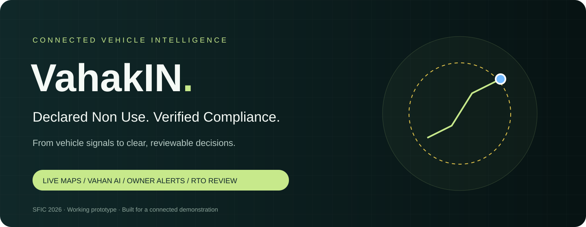

**A connected workspace for vehicle owners, transport officers, and the signals between them.**

[Product tour](#product-tour) · [VAHAN AI](#vahan-ai) · [Live demonstration](#live-demonstration) · [Hardware](#hardware) · [Run locally](#run-locally) · [Screenshot gallery](docs/media/GALLERY.md)


</div>

VahakIN connects **Non-Use declarations, device movement, phone-assisted location, geofence monitoring, and officer review** in one application. Owners can understand what was observed and respond. RTO teams can inspect scoped records, review applications, follow incidents, and evaluate evidence without confusing a sensor warning with a legal determination.

Built for **SFIC 2026 · PS000225 · Collector Office, Rajkot**, by **CSPIT, CHARUSAT University · TM002281**. The walking demonstration also supports the configured Gandhinagar office.

> **Prototype status:** This is not an approved government deployment or an official VAHAN integration. Seeded demonstrations are labelled, location sources are disclosed, and financial illustrations are not statutory fines.

## Product tour


| For vehicle owners | For transport teams |
|---|---|
| Guided enrolment and private document submission | Scoped application review and approval |
| Device assignment and placement confirmation | Vehicle registry and monitoring health |
| Phone location sharing beside the paired module | Live location, custom geofences, incident timeline |
| Movement requests and owner explanations | Alerts, investigations, and review history |
| WhatsApp warnings with a tracking link | Financial evidence and illustrative assessments |
| VAHAN AI workspace assistant | Reports, audit trail, and role-based access |

### One vehicle. Two perspectives.

| Government workspace | Owner workspace |
|---|---|
| 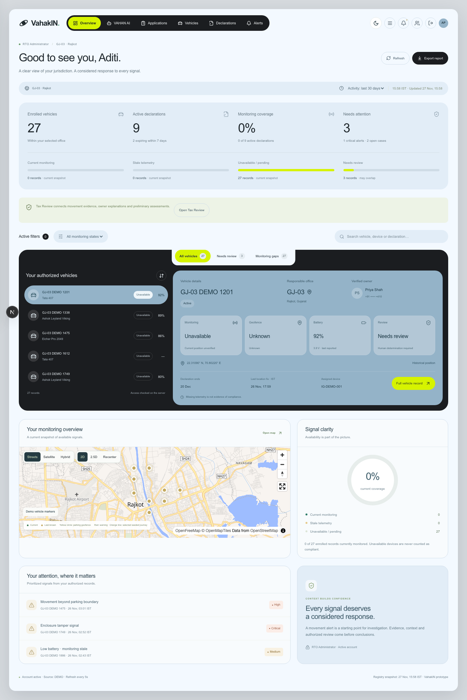 | 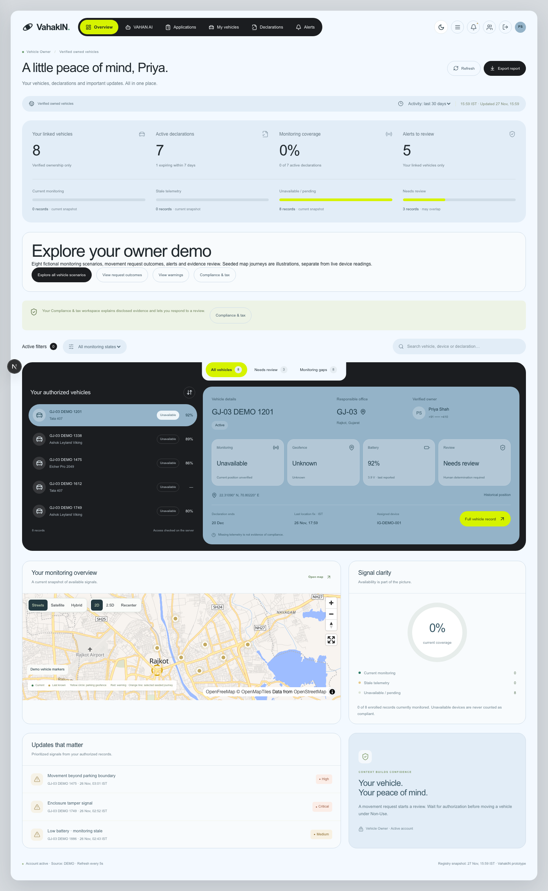 |
| 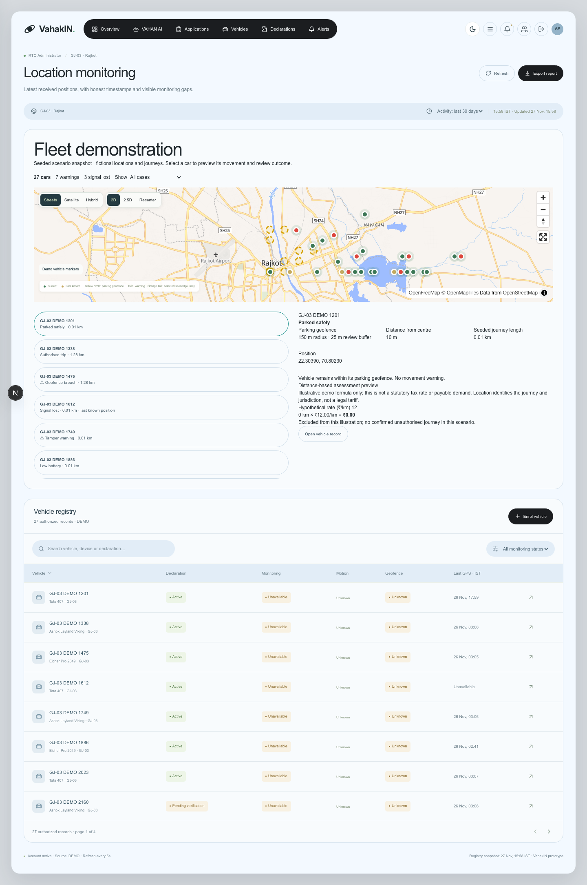 | 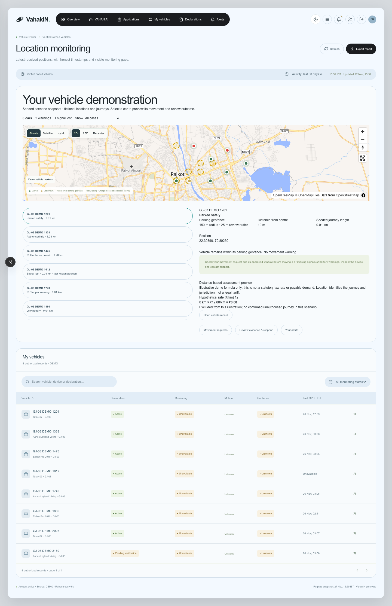 |
| 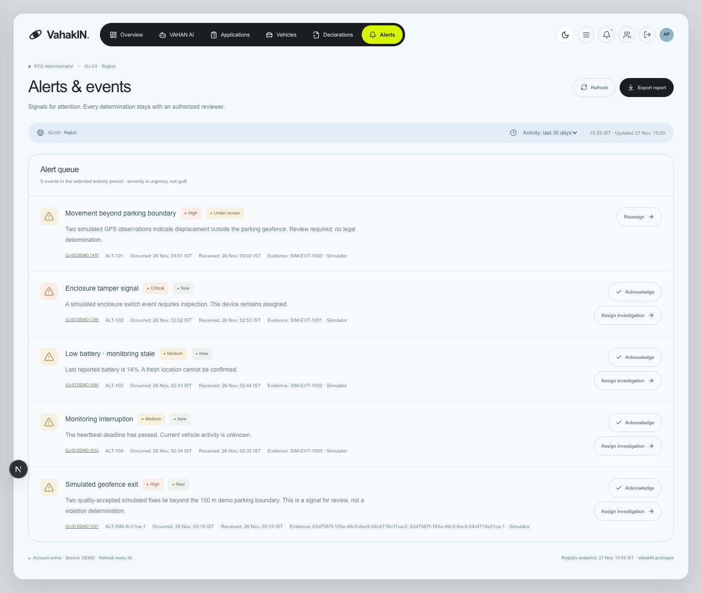 | 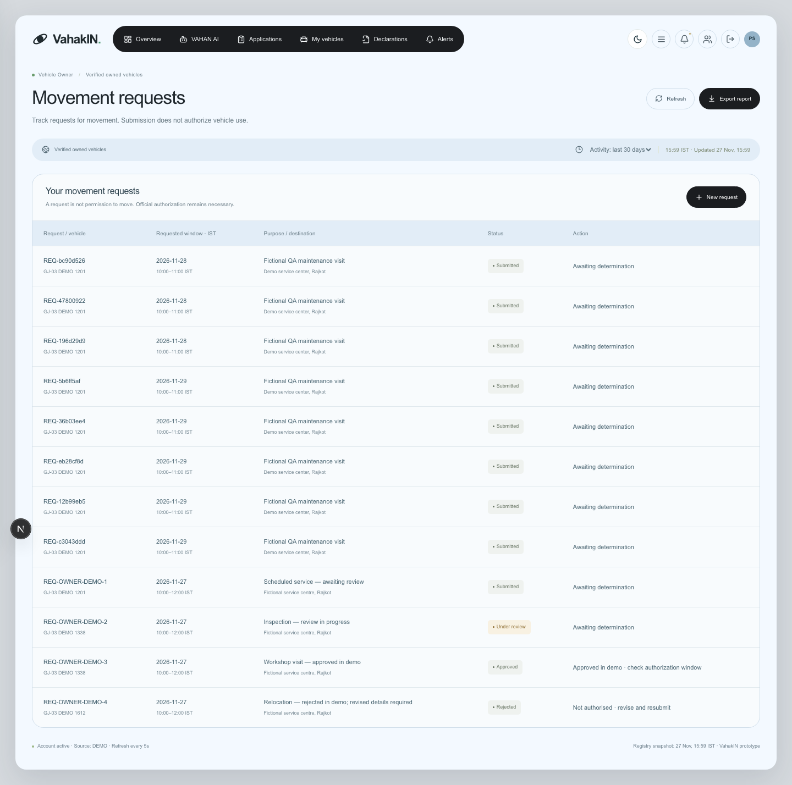 |

### VAHAN AI

A conversational interface alongside the records that matter: monitoring health, review context, and clear next steps. The assistant receives the authorised workspace summary when a conversation starts. It cannot approve applications, change records, or issue official decisions.

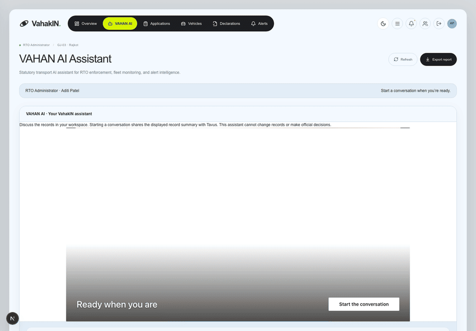

*Recorded interface walkthrough. An active conversation recording requires completing the embedded human-verification prompt; this GIF does not demonstrate a completed voice consultation.*

### Evidence before conclusions

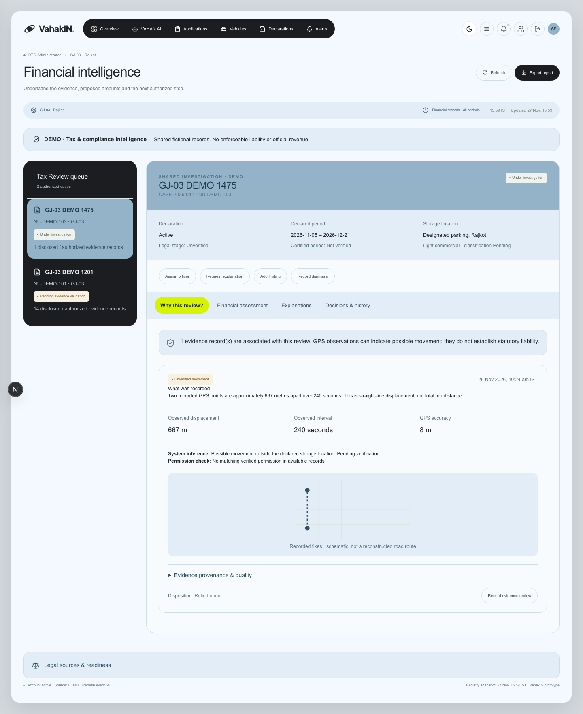

Movement, permission, location quality, declaration status, and financial interpretation remain separate. A noisy sensor, stale fix, or brief boundary crossing does not automatically establish liability. The walking POC’s configurable flow displays an **illustrative ₹12/km estimate** only for accepted travel after its allowance expires.

## Live demonstration

**A real module supplies motion. A co-located phone supplies position. The backend joins both against the same vehicle.**

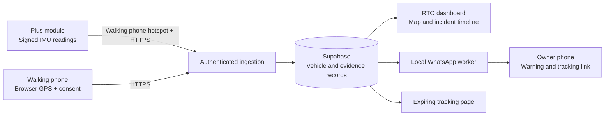

The laptop can stay on a different internet connection from the walking phone. The module sends telemetry through verified HTTPS; it does not depend on the laptop’s private Wi-Fi address in this configuration.

| Event | Owner experience | RTO experience |
|---|---|---|
| Sustained movement | Movement notification | Timestamped IMU event |
| Suspected handling | Local module siren and WhatsApp warning | Handling evidence in the timeline |
| Confirmed geofence exit | Return allowance and location link | Exit alert and countdown |
| Confirmed return | Prompt to park within three minutes | Return event and parking countdown |
| Five quiet seconds after return | Parked confirmation | Incident state updated |
| Allowance exceeded | Demo assessment notice | Illustrative distance calculation |
| GPS or module signal lost | Location availability shown honestly | Timers pause; no assumed exit |

### Warnings that reach the owner

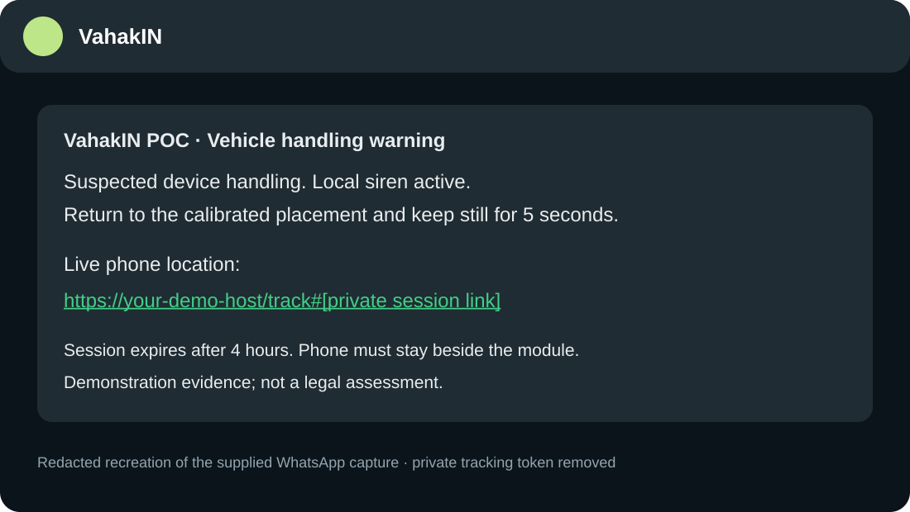

*Redacted recreation of the user-supplied WhatsApp message showing a delivered handling warning. The original private location token is intentionally excluded. The pictured message demonstrates handling notification, not proof of a completed geofence-exit test.*

Messages are sent through a linked WhatsApp account using **Baileys**, not carrier SMS. The link opens the application’s updating map; it is not WhatsApp’s native live-location feature. A tracking session expires after four hours and is revoked when the walk stops. Submission to the sender connection is not a recipient read receipt.

### Map behaviour

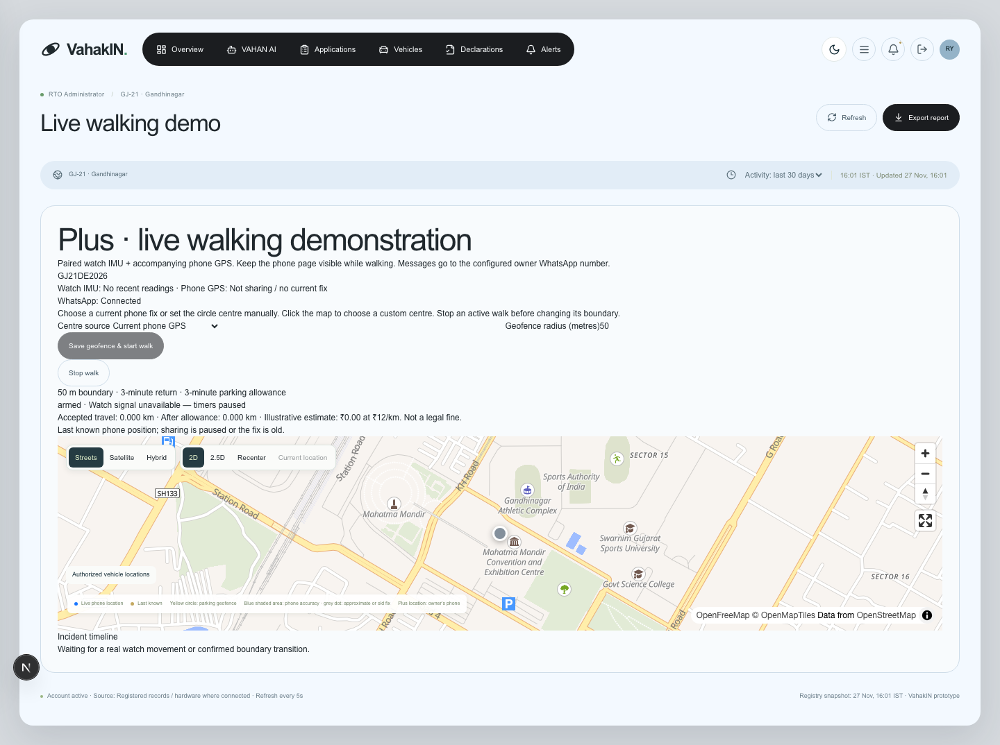

*Registered demonstration workspace at capture time; live signals depend on the paired module and consenting phone.*

- **Blue location dot:** fresh phone position, updated as accepted samples arrive.
- **Approximate/last-known position:** visibly distinguished from a current accurate fix.
- **Blue accuracy area:** the uncertainty reported by the phone.
- **Yellow geofence:** RTO-selected centre and radius, from **50 to 5,000 metres**.
- **Current location:** recentres on a current or approximate phone fix; **Recenter** fits the available vehicle and fence.
- A manual centre can be chosen on the map. Automatic phone-centred setup requires an accurate current fix.

Indoor GPS may be too inaccurate for a small fence. Approximate positions can appear on the map while remaining excluded from geofence decisions. Browser sharing retries temporary failures, renews expired sessions, and resumes when the page becomes visible again; continuous background GPS is not guaranteed.

## Hardware

| | VahakIN Basic | VahakIN Plus |
|---|---|---|
| Product direction | Vehicle-mounted monitoring module | **Custom-built module design with GSM and GPS support planned** |
| Motion | MPU6050 accelerometer and gyroscope | Six-axis IMU and handling detection |
| Location in current prototype | External NEO-6M receiver, subject to a valid fix | Co-located phone GPS shared with explicit consent |
| Current transport | Wi-Fi / hotspot | Wi-Fi / hotspot with verified HTTPS |
| Local interaction | Serial diagnostics | AMOLED touch interface and audible warning |
| Cellular status | Not used in the current demo | GSM integration is a product target, not demonstrated onboard connectivity |

The current Plus prototype validates the software and interaction flow on development hardware. **Integrated GSM and standalone GPS are not present in the demonstrated Plus configuration.** The custom module description expresses the intended product architecture.

Handling detection combines sustained tilt, rotation, and acceleration, following stationary calibration. The mounting reference is retained across restarts. The siren clears after five continuous quiet seconds near the calibrated orientation. An IMU alone cannot prove the device returned to its exact physical mounting point; a mounting-contact sensor is a future improvement.

The current exhibition firmware keeps the display, IMU and networking awake for visibility. The parked operating path has a 30-second inactivity setting and motion wake support. Physical battery-life and false-alarm validation remain necessary.

## Technology

| Layer | Implementation |
|---|---|
| Web application | Next.js App Router, React, TypeScript |
| Identity and storage | Supabase Auth, PostgreSQL, scoped server operations |
| Maps | MapLibre GL, OpenFreeMap street maps, optional MapTiler imagery |
| Validation | Zod, server-side permissions, bounded request bodies |
| Device transport | HMAC-SHA256 signatures, nonces, verified HTTPS |
| Firmware | C++, Arduino platform, LVGL, sensor and audio drivers |
| Owner messaging | Node.js worker, Baileys, persistent local session/outbox state |
| Verification | Vitest, Playwright, native C++ sensor-logic tests |
| Supporting project work | Python tooling, specifications and research deliverables |

## Run locally

```bash
cd apps/web
npm install
# Configure .env.local using the web settings documented in ../../.env.example.
npm run dev
```

| Workspace | Local URL |
|---|---|
| Public site | `http://localhost:3000` |
| Owner sign-in | `http://localhost:3000/login/owner` |
| Government sign-in | `http://localhost:3000/login/government` |
| Owner walking setup | `http://localhost:3000/owner/tracking` |
| RTO walking setup | `http://localhost:3000/gov/tracking` |

Live workspaces require Supabase configuration and the corresponding migrations in `supabase/migrations/`. Demo access must be enabled with the configured demo email and password hash. Real hardware ingestion uses separately provisioned per-device signing credentials.

### Run the walking session

1. Approve the owner’s Plus application through the RTO workflow, then confirm device placement as the owner.
2. Start the website and a trusted HTTPS endpoint reachable by the walking phone and module.
3. Configure the module’s private Wi-Fi, HTTPS endpoint and root certificate. Never disable certificate verification.
4. Start the messaging worker from `apps/web`:

   ```bash
   node --env-file=.env.local scripts/walk-bridge.mjs
   ```

5. Open the RTO walking page and link the configured WhatsApp sender using its QR code.
6. On the accompanying phone, sign in as the owner, consent to location sharing, and keep the page visible.
7. Select and save the geofence in the RTO workspace. Confirm fresh GPS and IMU signals before walking.
8. Return inside the circle and hold the module stationary to demonstrate the return and parking flow.

Private runtime settings and WhatsApp credentials live under ignored `apps/web/.provisioned/walk/`. The prototype worker runs as a single local process. Keep the laptop awake. Restarting a temporary tunnel can change its public URL; update both web settings and the firmware endpoint before continuing.

### Checks

```bash
cd apps/web
npm run typecheck
npm test -- tests/unit/phone-location.test.ts tests/unit/hardware.test.ts tests/unit/walk-engine.test.ts
npx vitest run --config vitest.phone.config.ts
npx playwright test tests/e2e/walk-setup.spec.ts
```

Browser tests require the running app; the real-account setup test additionally requires local provisioning credentials. Do not commit those credentials or browser traces containing them.

```bash
# From the repository root
c++ -std=c++17 firmware/tests/handling_alarm_test.cpp -o /tmp/handling-test
/tmp/handling-test
c++ -std=c++17 firmware/tests/watch_motion_test.cpp -o /tmp/motion-test
/tmp/motion-test
```

## Repository guide

```text
apps/web/          Website, scoped APIs, dashboards, messaging worker
firmware/          Device UI, signed transport, motion and handling logic
supabase/          Live-workspace database migrations
packages/          Shared contracts and client foundations
services/          Supporting API architecture
tools/            Provisioning, simulator, map and capture utilities
docs/             Specifications, implementation notes, screenshot gallery
deliverables/     Design previews, posters and research assets
```

## Screenshots and documentation

**[Browse the complete captured page gallery](docs/media/GALLERY.md)** — public pages, owner, government, operations and national-summary workspaces. Images come from the running application, primarily with fictional demo data; the registered RTO walking setup is identified in the gallery. Capture paths and timestamps are recorded in the [manifest](docs/media/screenshots/manifest.json).

- [Problem statement](docs/spec/problem%20statement.md)
- [System architecture](docs/spec/architecture.md)
- [Hardware specification](docs/spec/harware.md)
- [Database and contracts](docs/spec/database.md)
- [Implementation plan](docs/spec/implementation.md)
- [Owner onboarding](docs/implementation/owner-onboarding.md)
- [Tax and compliance](docs/implementation/tax-compliance.md)

---

<div align="center">

**VahakIN · Better visibility. Clearer evidence. Human decisions.**

</div>
