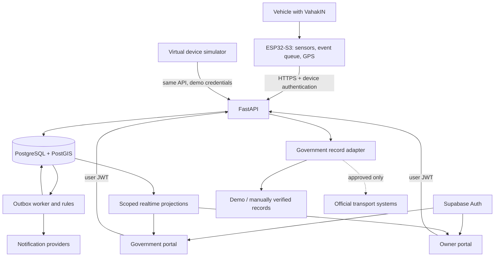
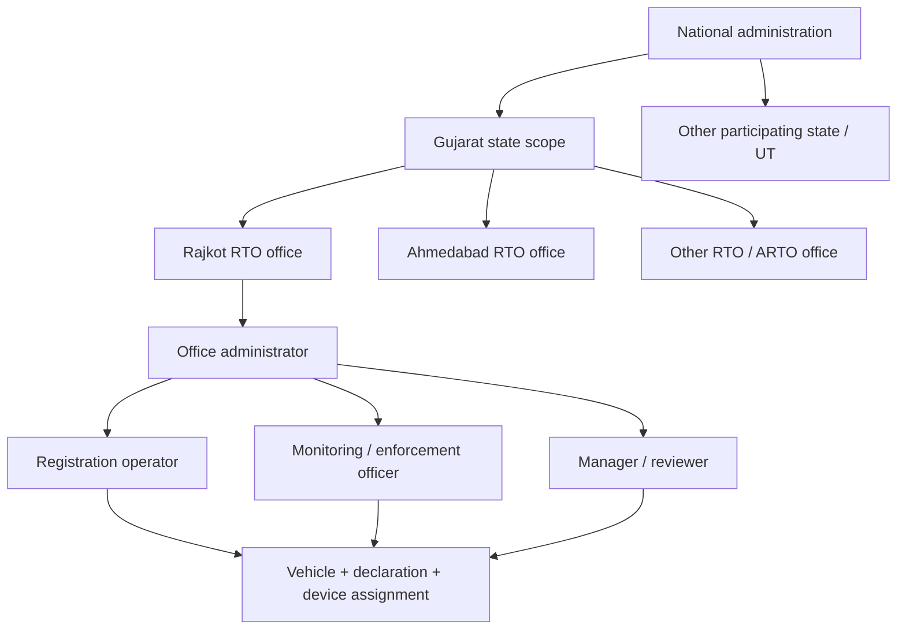
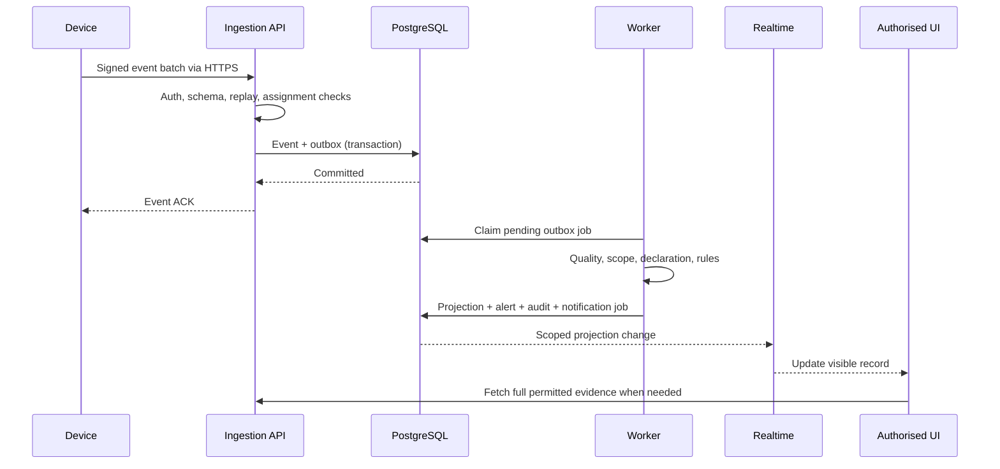

# VahakIN | System and website architecture

**Specification:** IG-ARC-02 · Revision 2.2 · 25 November 2026  
**Status:** Proposed architecture for a working SFIC prototype; deployable pilot requires approval  
**Read first:** [Problem statement](problem%20statement.md) · [Hardware](harware.md) · [Database](database.md) · [Implementation](implementation.md)

## 1. Architecture decisions

Build one centrally managed application with a government portal and a separate owner experience. Use the same server, domain services and database across all offices. Do not create applications or databases per state. The unit of operational authority is the RTO/ARTO office, not necessarily the district; multiple offices can serve one district. National/state views aggregate office records under authorised scope; office users perform enrolment and operational review. The hierarchy is a proposed software design inspired by centralised transport administration, not an assertion of official access rights.

| Decision | Selected baseline | Rationale |
|---|---|---|
| Web | Next.js App Router, TypeScript, Tailwind CSS, shadcn/ui, Lucide | Shared components, responsive layouts, type-safe UI |
| Maps | MapLibre GL JS + licensed tile provider | Map, boundaries, route history, clustering; no fake road routes |
| Charts | Recharts | Accessible summaries, charts with table alternatives |
| Backend | Python FastAPI modular monolith | One deployable API with isolated domain modules |
| Database | PostgreSQL + PostGIS, Supabase-managed for prototype | Transactions, spatial queries, RLS, migrations |
| Human identity | Supabase Auth | Session management; backend authorisation remains mandatory |
| Realtime | Supabase Realtime on scoped projection/notification tables; polling fallback | Avoid exposing raw telemetry indiscriminately |
| Device ingestion | Versioned HTTPS JSON API + device HMAC | Simple interoperable authenticated transport |
| Prototype transport | ESP32-S3 Wi-Fi/phone hotspot; SIM800L 2G only after secure compatibility tests | Owned modem may not support required modern TLS; no insecure production fallback |
| Deployment | Docker for API/worker, managed DB, hosted Next.js | Reproducible environments |
| Jobs | DB-backed durable outbox/job worker | Retry and transactional event handling, no Redis required initially |
| ML | Python scikit-learn; rule baseline, later lightweight embedded model | Evidence-led improvement |
| Government integration | Provider adapter with DEMO, MANUAL, OFFICIAL modes | No dependency on unapproved official API access |
| Future growth | MQTT over TLS, durable queue, partitioning, regional capacity | Introduce only after measured need |

Pin dependency versions in lockfiles at implementation time; do not hardcode speculative package releases. See [Implementation](implementation.md) for sequencing.

## 2. System context



The tracker produces observations, not final compliance decisions. The API checks identity, assignment, timestamps and data validity. A backend rules engine evaluates the correct declaration/policy at observation time and records derived evidence. Dashboards read scoped views. Government decisions and official status remain with authorised officers or authorised source systems.

## 3. Hierarchy, tenancy and governance



States/UTs and offices are reference entities; districts are optional geographic grouping, not the sole tenant key. Office codes must be data-driven and verified before production. A vehicle can physically move outside its registering jurisdiction without its administrative ownership changing. Cross-office transfer closes the previous operational assignment/ownership scope under an audited process rather than rewriting historical incidents.

A person's roles are assigned with scope and validity. National administrators can see aggregate authorised statistics by state/office; access to precise vehicle locations or individual cases requires explicit case-level permission. State administrators see their assigned state and its offices. Office administrators manage local operations; officers may be limited to assigned cases. Technical admins see diagnostics by default, not owner PII. Owners can access only their verified ownership relationship and its authorised period. A user may have multiple scoped memberships; switching an active scope in the UI cannot grant new permissions.

### 3.1 Permission matrix (baseline)

Legend: A = allowed within scope; R = read/aggregate; D = explicitly delegated; — = prohibited. Every cell additionally requires server-side scope enforcement, active membership and appropriate data minimisation.

| Operation | National | State | Office admin | Manager | Officer | Operator | Owner | Tech admin |
|---|---|---|---|---|---|---|---|---|
| National metrics | R | — | — | — | — | — | — | — |
| State metrics | R | R | — | — | — | — | — | — |
| Office metrics | R | R | R | R | R | R | — | D |
| Manage state admins | A | — | — | — | — | — | — | — |
| Manage office admins | D | A | — | — | — | — | — | — |
| Manage local staff | — | D | A | — | — | — | — | — |
| Enrol vehicle/declaration | — | — | A | D | D | A | — | — |
| Approve monitoring | — | — | D | A | D | — | — | — |
| View precise location | D | D | A | A | A | D | own | — |
| Create/assign investigation | — | D | A | A | D | — | — | — |
| Review/resolve investigation | — | D | D | A | D | — | own response only | — |
| Assign provisioned device | — | — | A | D | D | A | — | D |
| Manage device firmware | — | — | D | — | — | — | — | A |
| Export case evidence | D | D | A | A | D | — | permitted own copy | — |
| Change tax policy | D | D | — | — | — | — | — | — |
| Delete original evidence | — | — | — | — | — | — | — | — |

Account invitations and privilege escalation are audited. Users cannot assign a role higher than their permitted delegation. For approval actions use a maker/checker rule; a submitter cannot approve their own change where policy requires independent review. National visibility does not mean unrestricted export of all personal details.

## 4. Website information architecture

### 4.1 Public and identity routes

| Route | Content and behaviour |
|---|---|
| `/` | Hero, problem, concise workflow, owner/RTO benefits, responsible claims, demo CTA, links to login |
| `/about` | SFIC PS000225, scope, team, prototype status, no false official endorsement |
| `/how-it-works` | Non-Use lifecycle, hardware-to-dashboard illustration, reuse concept |
| `/impact` | Illustrative cost model and measurable outcomes, labelled assumptions |
| `/help` | FAQs, coverage/accuracy, support, privacy and accessibility |
| `/privacy` | Prototype data policy, monitoring purpose and retention contact |
| `/login/government` | Invited officer sign-in, MFA in pilot, no self-registration or role picker |
| `/login/owner` | Verified account sign-in; OTP only when implemented and configured |
| `/auth/callback` | Session exchange; validated redirect; never log credentials |
| `/unauthorized` | Safe access-denied state; no private record disclosure |

Do not imitate official logos, domains, government SSO or official certificates without permission. Demo accounts are separate from actual government identities.

### 4.2 Government portal routes

All routes reuse one protected shell: sidebar, top bar, scope breadcrumb, role badge, search, notifications, profile, context-aware filters, responsive collapse. Navigation is based on permissions returned by `/me`; the API enforces the same rules independently. Use query filters (date, scope, state, severity) reflected in the URL, with validated pagination.

| Route | Main UI | Actions and boundaries |
|---|---|---|
| `/gov` | Command centre: active declarations, monitored vehicles, observed stationary, suspicious incidents, unavailable, freshness, expiry, trends | National: state rollups; state: office rollups; office: case queue; officer: assigned work |
| `/gov/states` | State/UT table and authorised totals | National scoped navigation only; drill into permitted aggregate view |
| `/gov/offices` | RTO office list, district grouping, contact and activity | State/national admin invites/manages only delegated scopes |
| `/gov/offices/[id]` | Office overview, workload and monitoring quality | Access check; no location detail unless permitted |
| `/gov/vehicles` | Search by registration; filters by class, declaration, device and status | Register/import, verify, export only authorised fields |
| `/gov/vehicles/new` | Step wizard: record source, vehicle/owner, declaration, parking, assignment, review | Manual/demo source explicitly shown; validation; no arbitrary official verification claims |
| `/gov/vehicles/[id]` | Overview, map, timeline, declaration, device, alerts, evidence | Current vs last known location; assignment history; authorised edits |
| `/gov/declarations` | Drafts, pending, active, ending, expired | Review, activate monitoring, terminate with reason; no official approval claim |
| `/gov/monitoring` | Map and synchronised vehicle list, clustered markers, status and freshness | Click marker to open details; no global unauthorised raw location stream |
| `/gov/geofences` | Boundary map, versions, effective times | Create/approve updates; retain prior versions; configurable tolerance |
| `/gov/alerts` | Alert queue, severity, observation vs received time | Acknowledge; read/unread separate; deduplicated alerts |
| `/gov/investigations` | Case queue and assignees, filters | Create, assign, review, request explanation, resolve/dismiss/refer |
| `/gov/investigations/[id]` | Original evidence, journey map, policy version, owner response, action timeline | Append findings and generate evidence export; no edit to raw event |
| `/gov/compliance` | Suspicious journeys, review backlog, risk explanations | Financial estimates only if verified rule data exists; no automatic tax liability |
| `/gov/devices` | Device status, assignment, last heartbeat, signal/battery, firmware | Provision/assign/retire subject to permissions; never reveal credentials |
| `/gov/devices/[id]` | Device health and event timeline, config, command history | Queue configuration; pending/delivered/applied/failed status; OTA later |
| `/gov/employees` | Staff, membership, roles, invitations | Scope-limited role management and revocation |
| `/gov/reports` | Compliance, device health, case reports | CSV/PDF exports, audit and scope filter |
| `/gov/audit` | Authorised action timeline | Read-only, searchable, redact sensitive payloads |
| `/gov/settings` | Jurisdiction policies and alert settings | Versioned changes with effective date and reviewer |

Advanced pages may be labelled 'planned' or omitted from navigation until implemented. Never render a functional-looking action that silently does nothing. Prefer operational completeness over decorative placeholder modules.

### 4.3 Owner routes (mobile-first PWA)

`/owner` overview; `/owner/vehicles` list; `/owner/vehicles/[id]` vehicle summary; `/owner/vehicles/[id]/tracking` latest fix and permitted history; `/owner/alerts`; `/owner/declarations`; `/owner/requests`; `/owner/incidents/[id]` permitted case information and explanation submission; `/owner/documents`; `/owner/settings`; `/owner/support`.

Owner UI has simple language: location verified at time, device last contacted at time, monitoring status, relevant alerts, and actions to report unauthorised activity. Do not present a live pin if data is stale. Owner cannot delete telemetry, change approved geofences, switch off regulatory monitoring, or access another owner's vehicle. Do not expose internal officer notes unless policy allows.

### 4.4 Technical workspace

`/ops/devices`, `/ops/provisioning`, `/ops/firmware`, `/ops/health`, `/ops/integrations`, `/ops/audit`. Use restricted components from the shared application. The prototype needs only device registration, simulator control and health; signed firmware management is later. A simulator control panel is never available to normal owners/officers in production.

## 5. UI design system

Product name **VahakIN**; tagline **Declared Non Use. Verified Compliance.** Use restrained institutional visual identity, accessible contrast, neutral ivory/slate surfaces, navy or teal primary, semantic green/amber/red with text labels. The public page may use editorial Indian-inspired typography and subtle animations; operational dashboards prioritise density, usability and clarity over effects. Dark/light themes share tokens and semantic status meaning. Use `prefers-reduced-motion`, visible focus states, keyboard-accessible maps with alternative lists, responsive forms, semantic tables and accessible charts. Design translation keys for Gujarati/Hindi/English; only claim languages actually implemented.

Reusable UI primitives: `ScopeBreadcrumb`, `StatusBadge`, `FreshnessLabel`, `MetricCard`, `VehicleTable`, `VehicleMap`, `GeofenceEditor`, `EvidenceTimeline`, `TelemetryChart`, `DeviceHealthCard`, `AlertQueue`, `PermissionGate`, `EmptyState`, `ErrorState`, `LoadingSkeleton`, `ConfirmDialog`, `ExportDialog`, `SourceBadge`. Date/time store UTC; display Asia/Kolkata by default for Indian users and include timezone on exports. Never encode meaning with colour alone. Use obvious DEMO badges for synthetic data throughout.

## 6. Backend module boundaries

| Module | Responsibilities |
|---|---|
| identity | Verify JWT, active membership, permissions, scope, owner relations |
| jurisdictions | State/UT, district, offices, delegated hierarchy |
| registry | Vehicle, owner, verified source and office responsibility |
| declarations | Lifecycle, approvals, validity periods, official reference |
| devices | Provision, credential lifecycle, assignments, config, command queue |
| ingestion | Authenticate device, schema validation, replay checks, idempotency, immutable event write |
| geospatial | Quality-aware distance/boundary checks, versioned geofences |
| monitoring | Current projections, heartbeat deadlines, movement grouping |
| compliance | Versioned rules, suspected events, risk reasons, policy evaluation |
| cases | Alerts, incident lifecycle, assignment, owner explanations, review |
| reports | Scoped export, redaction and audit |
| integrations | DEMO/MANUAL/OFFICIAL providers, retry, provenance |
| notifications | Outbox consumers, delivery status, retry, preferences |
| audit | Append-only action log, correlation IDs, controlled retention |
| ops | Health, metrics, jobs, simulator controls and diagnostics |

HTTP handlers call services; services own transactions and authorisation; repositories implement parameterised queries. Avoid direct database calls from UI for privileged writes. Shared schema/DTO definitions and generated API client keep frontend types aligned. Use worker for slow jobs, not blocking request processing.

## 7. API contract (version 1)

Prefix `/api/v1`. Human endpoints require valid access token and permission; device endpoints use separate credentials. All responses use UTC timestamps; errors have `{ "error": { "code": "...", "message": "...", "request_id": "..." } }` with no secrets. Use cursor pagination (`limit`, `cursor`) for large lists. Validate all IDs, fields and filters; never trust a request `office_id` as authorisation.

| Method and endpoint | Use |
|---|---|
| GET `/me` | Effective roles, scopes and UI capabilities |
| GET `/states`, `/offices` | Permitted hierarchy |
| GET `/metrics/summary` | Scoped, time-filtered aggregate metrics |
| GET/POST `/vehicles` | Search / register with source provenance |
| GET/PATCH `/vehicles/{id}` | Read / permitted profile update, concurrency check |
| POST `/declarations` | Create draft |
| POST `/declarations/{id}/submit` | Request review |
| POST `/declarations/{id}/approve-monitoring` | Review action, not official tax approval |
| POST `/declarations/{id}/end-monitoring` | End monitoring under policy |
| GET/POST `/geofences` | Scoped versioned boundary reads/creation |
| GET `/vehicles/{id}/locations` | Authorised paginated position history |
| GET `/vehicles/{id}/journeys` | Journey summaries and segments |
| GET `/alerts` | Scoped alerts |
| POST `/alerts/{id}/acknowledge` | Audited acknowledgement |
| GET/POST `/incidents` | Review queue / create case |
| POST `/incidents/{id}/assign` | Assign officer |
| POST `/incidents/{id}/responses` | Owner explanation / permitted response |
| POST `/incidents/{id}/resolve` | Findings + disposition + reason |
| GET/POST `/devices` | Inventory / provision via authorised role |
| POST `/device-assignments` | Install / associate device with declaration |
| POST `/device-assignments/{id}/close` | Close assignment |
| POST `/devices/{id}/commands` | Queue versioned remote configuration |
| GET `/devices/{id}/commands` | Command lifecycle |
| POST `/reports` | Queue scoped export |
| GET `/reports/{id}` | Authorised export status and short-lived download |
| POST `/device/events` | Authenticated device telemetry batch |
| GET `/device/commands` | Fetch pending commands for authenticated assignment |
| POST `/device/command-results` | Idempotent command result |
| GET `/health/live`, `/health/ready` | Non-sensitive liveness/readiness |

Use HTTP 201 on created resource, 200 on successful duplicate event acknowledgement, 400/422 invalid request, 401 unauthenticated, 403 forbidden (or generic 404 for scoped object), 409 conflict, 429 rate limit, 503 retryable unavailable. For retryable network errors clients use capped exponential backoff with jitter. Do not retry permanent validation errors indefinitely.

## 8. Telemetry schema and device protocol

### 8.1 Envelope

Device event type enum: `heartbeat`, `position`, `motion_start`, `motion_sample`, `motion_end`, `case_tamper`, `mount_tamper`, `low_battery`, `boot`, `health`, `queue_overflow`. Fields below are representative version 1 contract; simulator and firmware use the same endpoint.

```json
{
  "schema_version": 1,
  "device_id": "IG-DEMO-001",
  "assignment_id": "11111111-1111-4111-8111-111111111111",
  "events": [
    {
      "event_id": "22222222-2222-4222-8222-222222222222",
      "boot_id": "33333333-3333-4333-8333-333333333333",
      "seq": 42,
      "type": "position",
      "observed_at": "2026-11-25T10:00:00Z",
      "clock_quality": "gnss",
      "uptime_ms": 172000,
      "position": {
        "lat": 22.3039, "lon": 70.8022,
        "fix_valid": true, "fix_at": "2026-11-25T10:00:00Z",
        "speed_mps": 0.4, "hdop": 1.7, "satellites": 7,
        "accuracy_m": null
      },
      "motion": {"state":"stationary_observed","rms_mps2":0.15,"window_ms":2000},
      "tamper": {"case_open":false,"mount_removed":false},
      "health": {"battery_mv":3950,"battery_pct":null,"rssi_dbm":null,"firmware":"0.1.0","config_version":1}
    }
  ]
}
```

The numeric coordinates are illustrative only. Unknown fields are null, not fake zero readings. `accuracy_m` may be unavailable on NEO-6M; HDOP is not itself a metre-valued accuracy estimate. GPS valid/stale must be derived from fix quality and freshness. `received_at` is server generated; device cannot set it. The simulator flag is server derived from credential/environment, never trusted from payload. All motion values document units; distinguish raw gravitational acceleration from dynamic acceleration. Maximum batch 50 events and 64 KiB body initially; larger waveforms stay in separate authorised research tooling.

### 8.2 Authentication and replay handling

- Per-device secret generated server-side/provisioned securely; distinct from user JWT and database keys. Secret storage encrypted at rest with restricted access; no shared fleet secret or repository credentials.
- TLS certificate and hostname verification required for real telemetry. If SIM800L cannot establish suitable TLS, use ESP32 Wi-Fi with a hotspot for prototype; do not transmit sensitive evidence over plaintext HTTP or disable certificate checks.
- Suggested headers: `X-Device-Id`, `X-Key-Id`, `X-Request-Id`, `X-Sent-At`, `X-Signature`. Canonical signed bytes: `v1\nPOST\n/api/v1/device/events\n{device_id}\n{key_id}\n{request_id}\n{sent_at}\n{hex_sha256(raw_body)}` (actual newline separators). Signature = hex HMAC-SHA256; constant-time compare. Use same convention with correct path/method on other endpoints, including signed query canonicalisation if query parameters are introduced.
- Fresh request timestamps (proposed ±5 min), unique request ID with bounded replay cache, and per-event stable IDs. Retries may reuse event IDs in a newly signed request; if identical request ID repeats, return cached result or require a fresh signature without reprocessing. Historical `observed_at` may be old for buffered events; do not reject legitimate queued events merely because observation time is old. Invalid clock -> obtain trusted time before signed upload; preserve unknown observation time with uptime and uncertainty.
- Validate device active credential, assignment ownership, assignment time range and declared event source. Unassigned provisioning uses a separate authenticated channel. Use a scoped token/credential rotation on reassignment; drain prior queue before handover or quarantine it for review. Never attribute an event to the newest assignment just because it arrives late.
- Persist raw accepted event and outbox in one DB transaction. Return ACK only after durable commit. Duplicates are recognised by stable event ID and payload hash; conflicting same ID quarantined/rejected. Sequence gaps and boot resets are health signals, not automatic proof of fraud.

Example ACK:

```json
{"accepted":["22222222-2222-4222-8222-222222222222"],"duplicates":[],"rejected":[],"server_time":"2026-11-25T10:00:04Z","next_report_seconds":21600}
```

Client removes only acknowledged accepted/duplicate events; invalid permanent items are logged/quarantined and reported, not endlessly retried. A failed batch transaction must not ACK partial uncommitted data. Commands have UUID, target assignment, config version, expiry, payload allowlist and result; sleeping tracker fetches on next connection. No arbitrary shell commands. Signed OTA later.

## 9. Compliance processing and real-time data flow



Workers use event-time rules and effective declaration/geofence/policy snapshots. Use deterministic dedupe keys for alerts and jobs. Out-of-order events may amend derived journeys, never replace newest valid projection with older observation. Mark amended reports appropriately. Heartbeat deadline = expected report time + grace; use separate moving and parked intervals. No current monitoring claim on missing contact. Notification retries do not duplicate alerts.

### 9.1 Geofencing

Persist a WGS84 point and radius in metres or validated polygon. PostGIS geography distance for circle; validated polygons with appropriate spatial predicates. Use configurable quality checks and hysteresis. E.g., two consecutive reliable fixes outside boundary plus displacement and motion evidence before escalating; initial values are test configuration, not official policy. Do not calculate distance from invalid/stale fixes. GPS drift, gaps, crossing uncertainty and moved device are independent reasons for uncertainty. The backend is authoritative for classification; device may use a local lightweight trigger only.

### 9.2 Risk and financial intelligence

Initial risk is explainable rules with capped score and reason contributions, versioned and configurable. Do not display numerical probabilities of guilt. Example signals: repeated unexplained journeys, corroborated displacement, tamper, monitoring gaps (gap is reliability issue, not fraud proof). Human review remains mandatory. Use observed activity timestamps and verified official rates for any estimated potential liability; if no verified rate, show 'not available'. Separate estimated, reviewed, assessed and recovered amounts. Do not auto-fine or write to official systems.

## 10. Government integrations and external services

`VehicleRecordsProvider` abstraction: `lookup_registration()`, `lookup_declaration()`, `lookup_tax_status()` where available; adapters `DemoProvider`, `ManualProvider`, `OfficialProvider` (disabled until credentials and approval). Store provenance, verification state, external reference and freshness. Mock records never show official verified badge. Manual verification records reviewer/time/source. Official integration stays server-side and read-only initially; access approval and actual schema must be obtained. No scraping or storing unnecessarily broad datasets. Reference [Parivahan](https://parivahan.gov.in/), [API Setu](https://directory.apisetu.gov.in/), [MoRTH data sharing policy](https://www.morth.gov.in/sites/default/files/circulars_document/Data-Sharing-policy-20082025-merged.pdf).

MapLibre needs a tile/style provider; use properly licensed provider with attribution and respect geocoding usage limits. Reverse geocoding optional, cached, no bulk public endpoint abuse. Push/email/SMS adapters use verified recipients, minimal location/PII in message body, opt-in where applicable. In-app notification and alert records remain primary. Reports stored privately with expiring download URLs and authorisation recheck.

## 11. Reliability, security, privacy and scale

- Human auth: MFA for privileged accounts in pilot; verified email/phone, short-lived sessions, secure cookie handling and CSRF protection where relevant; enforce scope on every API, export and realtime subscription. Never expose Supabase service-role key in browser. RLS is defence in depth, not a substitute for API checks.
- Network: HTTPS, restricted CORS, rate limits, request-size limits, secret management, dependency scanning, audit of privilege changes and exports. No secrets in logs, screenshots, sample data or firmware committed to Git.
- Data: minimum owner/vehicle fields, private precise coordinates, purpose limitation, retention review, encrypted backups, deletion/retention process under approved policy. Separate demo/production databases and device credentials; no real owner data in public demo.
- Evidence: append-only application permissions; original payload/hash, receipt and policy snapshot; controlled backup and export manifest. Hashing does not guarantee non-repudiation or legal admissibility; independent anchoring and validated procedure later.
- Jobs: transactional outbox, claim with row locks, retry with jitter, lease recovery, dead-letter after capped retries, idempotent handlers. Monitor queue lag, ingest error/latency, heartbeat gaps, API errors, DB saturation and disk usage. Redact PII.
- Realtime: RLS-authorised minimal projection tables; reload canonical API state on reconnect; fall back to bounded polling (e.g. 15–30 s). No fake realtime when device sleeps; show observation and receive timestamps. Scope change unsubscribes and clears private cached records.
- Capacity: with 10,000 mostly parked devices and 4 heartbeats/day, baseline is 40,000 reports/day (~0.46/s average); burst, active movement and retries dominate. Example 1,000 simultaneous devices reporting once/min = ~16.7 reports/s before retries. Benchmark burst and sustained load; never equate these examples with proven capacity. Partition telemetry by time later; use indexes, rollups and retention. Add queue broker/read replicas only with evidence.
- Deployment: separate dev/demo/staging/prod, automated migrations and backups, restore drill, observability, incident runbook, rollback. Hosting/data residency and regulatory approvals require authority decisions.

## 12. Architecture acceptance checklist

- [ ] One deployed website; government and owner login; role resolved from authenticated account.
- [ ] Operator enrols one vehicle; office/state/national permitted totals reflect it once.
- [ ] Cross-office and cross-owner direct API/DB/realtime attempts rejected.
- [ ] Real or simulated authenticated event updates map/timeline after durable commit.
- [ ] Demo source and real hardware data never conflated.
- [ ] Duplicate/out-of-order events and delayed fixes handled correctly.
- [ ] Movement/tamper/heartbeat gap visible with evidence and timestamps.
- [ ] Owner notification and officer review work end-to-end.
- [ ] No official API claim, automatic penalty or unsupported secure cellular claim.
- [ ] Data is protected, backup restores, and monitoring expiry stops prospective evaluations.
