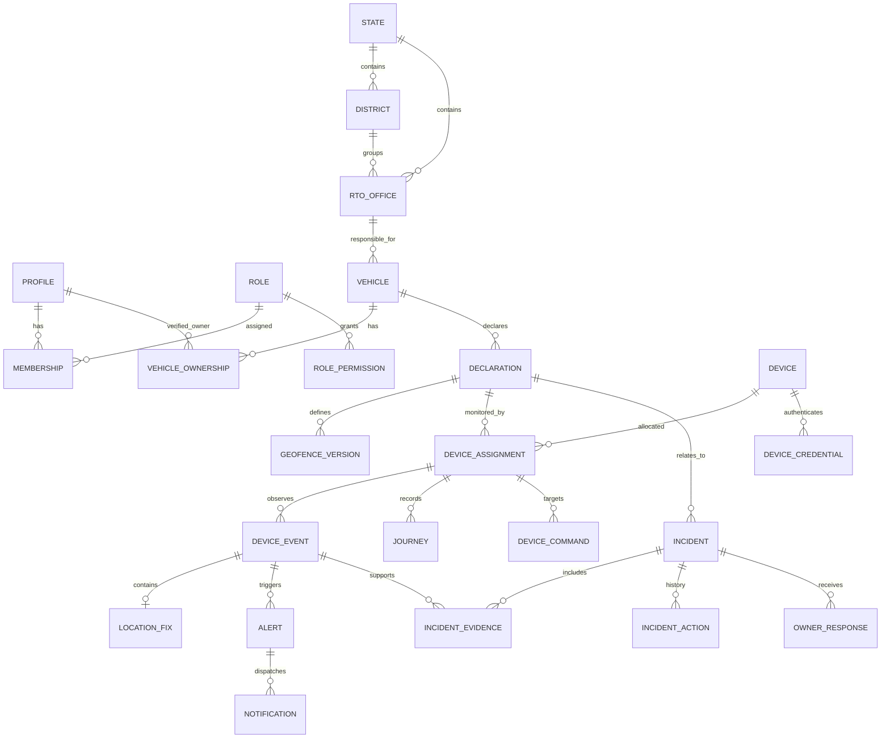

# VahakIN | Database, data contracts and security design

**Specification:** IG-DB-04 · Revision 2.2 · 25 November 2026  
**Database:** PostgreSQL + PostGIS, initially hosted on Supabase  
**Status:** Logical schema and migration contract; not yet applied to a database  
**Related:** [Problem statement](problem%20statement.md) · [Architecture](architecture.md) · [Hardware](harware.md) · [Implementation](implementation.md)

## 1. Design objectives

Maintain a single authoritative application database for participating states, RTO/ARTO offices, owners, vehicles, declarations, device assignments, monitoring evidence and investigations. A vehicle is enrolled once at the responsible office and authorised aggregate data rolls up to state/national views. Official transport systems remain authoritative for government registration, declaration and tax records; VahakIN stores permitted references/snapshots and original monitoring observations. No separate database per office in the MVP.

Every record must carry enough identity, scope, time and provenance to determine who may access it and what it means. An event belongs to the device assignment at observation time, not whichever vehicle currently holds the device. Compliance, activity, location quality and communication health are separate dimensions. Raw monitoring evidence must not be overwritten by an officer, owner or worker.

Use UUID primary keys for entity IDs (except natural reference codes where appropriate), `timestamptz` in UTC, `numeric` for money, `bigint` for sequence/uptime, `jsonb` for bounded extensible metadata, and PostGIS `geography` for metre-based distances. `created_at` is DB-generated; `updated_at` only on mutable entities. Use explicit constraints, unique indexes, transactional service commands and migration scripts, not undocumented UI assumptions.

## 2. Data model overview



The diagram omits policy versions, access scopes, projections and operational jobs for readability. The dictionary below is normative for the MVP. `R` = required/not null; `O` = optional/nullable. `FK` references a table ID unless stated. P0 tables are implemented first; P1/P2 later unless needed for a working feature. An empty/disabled module must not be represented as complete.

## 3. Data ownership, tenancy and scope

`rto_offices.state_id` identifies the state scope; `district_id` is optional geographical grouping. `vehicles.responsible_office_id` is current administrative responsibility. `declarations.office_id` and `device_assignments.office_id` are historical snapshots, validated when created. Events and cases inherit the assignment/declaration office scope at observation time. Office transfers are explicit, effective-dated and audited. Do not mutate historic event office IDs to match a new transfer. Physical GPS location does not decide administrative jurisdiction.

Human access uses `memberships` with role, scope and validity. A membership can be national (all state/office fields null), state (state only), office (office only), or self/technical as appropriate. Explicit permission checks determine actions; a role label does not grant universal raw location access. For owner access use verified effective-dated ownership and allowed incident/assignment period. All backend queries derive scope from authenticated identity; do not trust client-supplied `state_id`, `office_id` or `owner_id` as grants.

Demo data has server-controlled environment/credential provenance; prefer a separate database/project for demo vs pilot. Do not mix real and synthetic owner records. Public demo roles have fictional identity and synthetic vehicles. If a physical test device is used, tag it `test_hardware` and do not represent it as an enrolled real government vehicle.

## 4. Identity and administrative reference tables (P0)

### `states`
- `id uuid PK R`, `code text UNIQUE R`, `name text R`, `kind text R` (`state`,`union_territory`), `active boolean R default true`, `created_at timestamptz R`.
- Seed reference data only after verification for production; synthetic seeds sufficient for prototype.

### `districts`
- `id uuid PK R`, `state_id uuid FK states R`, `code text R`, `name text R`, `active boolean R`.
- Unique `(state_id, code)`. Districts are grouping, not access authority by themselves.

### `rto_offices`
- `id uuid PK R`, `state_id uuid FK R`, `district_id uuid FK O`, `office_code text UNIQUE R`, `name text R`, `office_type text R` (`rto`,`arto`,`other`), `address text O`, `active boolean R`, `created_at`, `updated_at`.
- If district set, enforce same state via composite FK or transaction/trigger. Index `(state_id, active)`, `(district_id)`.

### `profiles`
- `id uuid PK R` referencing `auth.users.id`, `display_name text R`, `email text O`, `phone_e164 text O`, `account_status text R` (`invited`,`active`,`suspended`,`revoked`), `locale text R`, `created_at`, `updated_at`.
- Supabase Auth stores authentication credentials. Never store plaintext password, OTP, refresh token or MFA secret in app tables. Limit duplication of contact fields to operational necessity; private read rules. Employee identifier may be stored in scoped membership/profile metadata rather than exposed publicly.

### `roles`, `permissions`, `role_permissions`
- `roles(id uuid PK, code text UNIQUE, name text, active boolean)`; codes `national_admin`, `state_admin`, `rto_admin`, `rto_manager`, `rto_officer`, `registration_operator`, `vehicle_owner`, `technical_admin`.
- `permissions(id uuid PK, code text UNIQUE, description text)`; examples `metrics.read`, `vehicle.read`, `vehicle.enrol`, `location.precise.read`, `declaration.review`, `device.assign`, `incident.resolve`, `employee.invite`, `report.export`, `firmware.manage`.
- `role_permissions(role_id FK, permission_id FK, PRIMARY KEY(role_id,permission_id))`. Manage via audited migrations/policy changes, not client toggles.

### `memberships`
- `id uuid PK`, `user_id FK profiles`, `role_id FK roles`, `scope_type text R` (`national`,`state`,`office`,`self`,`technical`), `state_id FK O`, `office_id FK O`, `employee_ref text O`, `valid_from timestamptz R`, `valid_to timestamptz O`, `status text R` (`invited`,`active`,`revoked`), `granted_by FK profiles O`, `revoked_by FK O`, `reason text O`, `created_at`.
- CHECK scope shape (state only for state, office only for office; other scope types neither), end > start. Active role and scope required. Prevent duplicate active equivalent membership with partial unique expression or service lock. Index `(user_id,status,valid_from)`, `(office_id,status)`, `(state_id,status)`. Permission delegation must be checked server-side. Revocation invalidates access immediately through current DB membership check, not stale claims alone.

### `case_access_grants` (P1; explicit case-level cross-scope access)
`id`, `user_id`, `incident_id`, `permission_code`, `granted_by`, `valid_from`, `valid_to`, `reason`, `revoked_at`. Restrict to authorised grants; no default nationwide location access. P0 higher scopes are aggregate-only unless a permitted explicit assignment exists.

## 5. Vehicle, ownership and Non-Use declarations (P0)

### `vehicles`
- `id uuid PK`, `registration_number text R`, `registration_normalized text UNIQUE R`, `responsible_office_id FK rto_offices R`, `vehicle_class text R`, `manufacturer text O`, `model text O`, `fuel_type text O`, `registration_date date O`, `external_vehicle_ref text O`, `record_source text R` (`demo`,`manual`,`official`), `verification_status text R` (`unverified`,`pending`,`verified`,`rejected`), `verified_by FK profiles O`, `verified_at timestamptz O`, `active boolean R`, `created_by FK profiles R`, `created_at`, `updated_at`, `row_version int R`.
- Normalise registration by uppercase/remove approved separators, retain original display string; do not impose a Gujarat-only pattern nationally. Official references may require uniqueness by provider. Minimise chassis/engine identifiers; no unnecessary Aadhaar or full documents in MVP. Index `(responsible_office_id, active)`, registration search, `(vehicle_class)`.

### `vehicle_ownerships`
- `id uuid PK`, `vehicle_id FK R`, `owner_user_id FK profiles O`, `owner_display_name text R`, `owner_contact_encrypted text O` (or restricted contact reference), `relation text R`, `verification_status text R`, `verified_by FK O`, `verified_at O`, `valid_from timestamptz R`, `valid_to O`, `source text R`, `created_at`.
- Supports registration before owner login and verified linkage later; prevent overlapping primary-owner ranges where applicable. Owner only gains access through active verified relationship plus applicable historic visibility policy. Index `(owner_user_id, verification_status)`, `(vehicle_id, valid_from)`.

### `vehicle_office_history`
`id`, `vehicle_id`, `office_id`, `valid_from`, `valid_to`, `transfer_reference`, `approved_by`, `reason`. Enforce non-overlap for office responsibility periods. Record prior scope when transfers occur; do not delete historical events.

### `declarations`
- `id uuid PK`, `vehicle_id FK R`, `office_id FK R`, `external_reference text O`, `source text R` (`demo`,`manual`,`official`), `verification_status text R`, `official_status text O`, `status text R` (`draft`,`pending_review`,`approved`,`active`,`expired`,`terminated`,`rejected`), `starts_at timestamptz R`, `ends_at timestamptz R`, `monitoring_started_at O`, `monitoring_ended_at O`, `declared_address text O`, `declared_point geography(Point,4326) O`, `reason_code text O`, `notes text O` (restricted), `submitted_by FK R`, `reviewed_by FK O`, `reviewed_at O`, `termination_reason O`, `policy_version_id FK O`, `created_at`, `updated_at`, `row_version int R`.
- CHECK ends > starts; monitoring interval inside applicable approved interval unless explicitly permitted and documented. No overlapping approved/active declaration for same vehicle (exclusion constraint). `official_status` distinct from local monitoring workflow. `reviewed_by` cannot equal submitter where maker/checker policy applies. Index `(office_id,status,ends_at)`, `(vehicle_id,starts_at desc)`.

### `declaration_actions` (append-only)
`id`, `declaration_id`, `actor_id`, `from_status`, `to_status`, `action`, `reason`, `occurred_at`, `source_reference`, `request_id`. Preserve reasons and status transitions. Scheduled expiry uses a system actor marker rather than pretending an officer acted.

### `geofence_versions`
- `id uuid PK`, `declaration_id FK R`, `version int R`, `shape text R` (`circle`,`polygon`), `center geography(Point,4326) O`, `radius_m numeric O`, `polygon geography(Polygon,4326) O`, `hysteresis_m numeric R`, `quality_policy jsonb R`, `effective_from timestamptz R`, `effective_to O`, `created_by FK R`, `approved_by FK O`, `status text R`, `created_at`.
- Unique `(declaration_id,version)`. Circle requires center and positive radius; polygon requires valid closed non-self-intersecting geometry (validate with PostGIS geometry), shape inputs mutually exclusive. Effective periods for approved versions do not overlap. Index GiST on point/polygon and declaration effective dates. Retain version even after change. For MVP circle first; polygon may be deferred.

### `movement_authorisations` (P1)
`id`, `declaration_id`, `requested_by`, `reviewed_by`, `official_reference`, `status`, `valid_from`, `valid_to`, `reason`, `allowed_area/conditions jsonb`, `created_at`, `reviewed_at`. An app approval does not replace legally required permission; only reviewed authorisation with official provenance affects policy. Check event time and actual conditions; otherwise mark review required.

## 6. Devices, credentials and assignments (P0)

### `devices`
- `id uuid PK`, `public_device_id text UNIQUE R` (e.g. IG-DEMO-001), `hardware_revision text R`, `serial_number text O UNIQUE`, `transport_capabilities jsonb R`, `firmware_version text O`, `config_version int R default 1`, `inventory_office_id FK O`, `lifecycle_status text R` (`provisioned`,`available`,`assigned`,`maintenance`,`retired`), `source_kind text R` (`simulator`,`test_hardware`,`pilot_hardware`), `provisioned_at`, `provisioned_by`, `created_at`, `updated_at`.
- No private credentials in client-readable device rows. Inventory office not an authorisation substitute for assignment scope. Index `(inventory_office_id,lifecycle_status)`.

### `device_credentials` (private schema)
`id uuid PK`, `device_id FK R`, `key_id text R`, `secret_ciphertext bytea R` or external secret-store reference, `valid_from`, `valid_to`, `revoked_at`, `created_by`, `created_at`. Unique `(device_id,key_id)`; encrypt with managed key not stored alongside ciphertext; only ingestion/provisioning service can access. Never send secret back after provisioning. HMAC verification requires secret or equivalent secure verifier; simple hash alone is not sufficient for HMAC. Rotate on compromise/reuse; keep controlled historical verification capability only if policy permits.

### `device_assignments`
- `id uuid PK`, `device_id FK R`, `vehicle_id FK R`, `declaration_id FK R`, `office_id FK R`, `assigned_at timestamptz R`, `ended_at O`, `status text R` (`pending_install`,`active`,`closed`,`cancelled`), `assigned_by FK R`, `installed_by FK O`, `installed_at O`, `initial_fix geography(Point,4326) O`, `seal_id text O`, `installation_notes text O`, `verified_by FK O`, `end_reason text O`, `created_at`.
- Device/vehicle/declaration/office consistency enforced in transaction and composite FKs where practical. At most one active assignment per device and vehicle; no overlapping assignment ranges. End after start. Reuse workflow drains/quarantines old queue and rotates credentials; late events never attach to new assignment by default. Index `(device_id,assigned_at desc)`, `(vehicle_id,assigned_at desc)`, `(office_id,status)`.

### `device_configs` (P1)
`id`, `device_id`, `assignment_id`, `version`, `config jsonb`, `status`, `created_by`, `created_at`, `effective_at`, `applied_at`, `failure_reason`. Unique `(device_id,version)`. Validate allowlisted reporting intervals, thresholds and limits; no arbitrary commands. Device may remain on older config until ACK; display requested vs applied version.

### `device_commands` (P1)
`id uuid PK`, `device_id`, `assignment_id`, `config_version`, `command_type`, `payload jsonb`, `status` (`queued`,`delivered`,`applied`,`failed`,`expired`,`cancelled`), `created_by`, `created_at`, `expires_at`, `delivered_at`, `result_at`, `result_code`, `result jsonb`. Command ID idempotency, explicit expiry, assignment auth, device result authenticated. No remote shell. Index `(device_id,status,expires_at)`.

### `firmware_releases`, `device_maintenance` (P2)
Firmware release: version, hardware revision, private artifact URI, SHA-256, signature metadata, status, rollout scope, created/reviewed timestamps; no unsigned OTA. Maintenance record: device, office, inspection date, battery health, seal, return/reuse, technician, action and status. Rental/deposit records only after approved policy; use separate financial ledger and never infer tax status from rental status.

## 7. Telemetry and monitoring (P0)

### `device_events` — immutable observations

| Column | Type | Meaning |
|---|---|---|
| `id` | UUID PK | Server row identity |
| `device_id` | UUID FK R | Authenticated device |
| `assignment_id` | UUID FK R | Assignment identity from verified association |
| `office_id` | UUID FK R | Historical scope snapshot |
| `event_id` | UUID R | Stable device-generated event ID |
| `boot_id` | UUID R | Boot session identifier |
| `seq` | bigint R | Non-negative sequence within boot |
| `event_type` | text R | Versioned enum defined in architecture |
| `schema_version` | int R | Payload schema |
| `observed_at` | timestamptz O | Actual observation time, nullable if unknown |
| `received_at` | timestamptz R | Server receipt time |
| `clock_quality` | text R | `gnss`,`ntp`,`estimated`,`unknown` |
| `uptime_ms` | bigint O | Local time since boot |
| `payload` | jsonb R | Validated original event data |
| `payload_hash` | bytea R | Hash of canonical individual event representation |
| `source_kind` | text R | Server-derived origin |
| `credential_key_id` | text R | Auth provenance, not secret |
| `request_id` | UUID R | Correlation/replay trace |

Unique `(device_id,event_id)` and optionally `(device_id,boot_id,seq)` if firmware guarantees unique seq. Same event ID with different canonical hash is conflict/quarantine, not overwrite. Do not use request-body hash for individual event dedupe when batch grouping changes. Define canonical JSON serialisation in shared contract/test vectors. Index `(assignment_id,observed_at desc)`, `(office_id,received_at desc)`, `(device_id,received_at desc)`; add BRIN on receipt time for large append-only stream. Never put raw unrestricted telemetry in public realtime publication. If later time partitioning, preserve global dedupe via separate event-key table (Postgres partition unique keys must include partition key) and transact key+row together.

### `location_fixes`
`id uuid PK`, `event_id uuid FK device_events UNIQUE R` (server row ID), `assignment_id FK R`, `fix_at timestamptz O`, `point geography(Point,4326) O`, `fix_valid bool R`, `speed_mps numeric O`, `hdop numeric O`, `satellites int O`, `accuracy_m numeric O`, `quality_status text R` (`valid`,`uncertain`,`invalid`), `quality_reasons jsonb R`, `created_at`.

Reject invalid latitude/longitude range, NaN/infinity and malformed units. Invalid fix has null point unless explicitly retained as raw untrusted payload; never use for map or distance. Unknown accuracy remains null; HDOP is dimensionless. Index GiST on point and `(assignment_id,fix_at desc)`; preserve observation vs fix vs received time. Normalised rows are derived from original event and can be rebuilt/versioned as needed.

### `monitoring_state` — mutable read projection
`assignment_id uuid PK`, `office_id`, `device_id`, `vehicle_id`, `declaration_id`, `last_contact_at`, `expected_next_contact_at`, `last_valid_fix_id`, `last_valid_fix_at`, `location_status`, `monitoring_status`, `activity_status`, `battery_mv O`, `battery_pct O`, `rssi_dbm O`, `case_open O`, `mount_removed O`, `tamper_status`, `firmware_version O`, `config_version O`, `last_event_id O`, `last_observed_at O`, `updated_at`, `projection_version bigint`.

Freshness derived by timestamps and policy. Projection updates must be monotonic by observation time where meaningful, but receipt-based health can update independently. A late old position must not regress latest valid fix. Keep per-signal freshness when needed. On mount tamper mark vehicle/device location association uncertain. This table is for scoped UI and realtime; minimise fields per role. Index `(office_id,monitoring_status)`, `(expected_next_contact_at)`, `(vehicle_id)`.

### `journeys`
`id`, `assignment_id`, `declaration_id`, `office_id`, `started_at`, `ended_at O`, `start_fix_id O`, `end_fix_id O`, `observed_distance_m O`, `max_speed_mps O`, `status` (`open`,`closed`,`uncertain`), `quality_summary jsonb`, `rule_version`, `revision int`, `created_at`, `updated_at`. Distance = sum of reliable observed segments, not guaranteed odometer distance or shortest routed road distance. Gaps labelled explicitly; no interpolation represented as fact. `journey_events(journey_id,event_id,sequence,PK(journey_id,event_id))`. Reconcile late events in deterministic worker, retain revisions and evidence references. Index assignment/start time, office/start time.

### `heartbeat_gaps` (P1)
`id`, `assignment_id`, `expected_at`, `detected_at`, `recovered_at O`, `reason_code`, `status`, `related_alert_id O`. Derive from expected interval + grace; one open gap per assignment; close on qualifying contact. Monitoring unavailable is not a fraud finding.

## 8. Alerts, cases and evidence (P0)

### `alerts`
`id uuid PK`, `office_id`, `declaration_id`, `assignment_id`, `trigger_event_id FK device_events O`, `alert_type text`, `severity text` (`info`,`low`,`medium`,`high`,`critical`), `status text` (`open`,`acknowledged`,`closed`,`dismissed`), `title`, `summary`, `reason_codes jsonb`, `rule_version text`, `dedupe_key text UNIQUE`, `observed_at O`, `created_at`, `acknowledged_by O`, `acknowledged_at O`, `closed_at O`, `source_kind`.

One deterministic alert key per rule/event or heartbeat-gap episode; repeat events can attach to existing incident, not create unbounded duplicates. Index `(office_id,status,severity,created_at desc)`, `(assignment_id,created_at desc)`. Separate recipient read state in notifications. Severity is a triage aid, not legal guilt.

### `incidents`
`id`, `office_id`, `declaration_id`, `vehicle_id`, `assignment_id O`, `case_ref text UNIQUE`, `incident_type`, `status` (`open`,`acknowledged`,`investigating`,`awaiting_explanation`,`resolved`,`dismissed`,`referred`), `priority`, `assigned_officer_id O`, `opened_at`, `closed_at O`, `outcome_code O` (`observed_movement`,`authorised`,`false_alarm`,`inconclusive`,`referred` etc.), `summary`, `resolution_reason O`, `reviewed_by O`, `policy_version_id O`, `row_version`, `created_at`, `updated_at`.

Transition service validates current status, permissions and maker/checker. Case resolution adds evidence/action row; does not change original observation. Index office/status/priority, assignee/status, vehicle/date. A confirmed observed movement is not automatically a legally confirmed violation.

### `incident_evidence`
`id`, `incident_id`, `device_event_id O`, `journey_id O`, `alert_id O`, `document_id O`, `evidence_type`, `description`, `source_hash O`, `added_by O`, `added_at`, `snapshot jsonb O`. At least one evidence reference or documented note. Restrict scope consistency. Raw references immutable; reviewer additions append. `incident_actions(id, incident_id, actor_id O, action, from_status, to_status, reason, occurred_at, request_id)` captures history, including reassignment and owner communication.

### `owner_responses`
`id`, `incident_id`, `owner_user_id`, `message text`, `submitted_at`, `document_id O`, `review_status`, `reviewed_by O`, `reviewed_at O`. Verify owner entitlement to incident and response; append correction instead of overwriting previous statements. Restrict private officer notes.

### `notifications`
`id`, `recipient_user_id`, `alert_id O`, `incident_id O`, `channel` (`in_app`,`email`,`push`,`sms`), `template_code`, `dedupe_key UNIQUE`, `status` (`queued`,`sent`,`failed`,`read` or separate delivery/read fields), `created_at`, `sent_at O`, `read_at O`, `attempts`, `provider_reference O`, `last_error_code O`. Avoid detailed coordinates/PII in third-party payload; in-app link requires auth. User can mark own notifications read, not close officer alert.

## 9. Policies, financial and official integrations (P1/P2)

| Table | Core fields and rules |
|---|---|
| `policy_versions` | `id`, `scope_type`, `state_id/office_id`, `version`, `effective_from/to`, `rules jsonb`, `approved_by`, `source_reference`, `status`, `created_at`. Explicit precedence office > state > national only where delegated; immutable effective versions. |
| `risk_assessments` | `id`, `declaration_id`, `office_id`, `computed_at`, `score 0..100`, `reason_contributions jsonb`, `rule_version`, `input_window_start/end`; score is review priority, not probability of guilt. |
| `tax_rule_versions` | `id`, `state_id`, `vehicle_class`, `effective_from/to`, `rate_data jsonb`, `official_source`, `verified_by/at`, `status`; no demo rate marked official. |
| `financial_assessments` | `id`, `incident_id`, `tax_rule_version_id`, `currency='INR'`, `estimated_amount numeric(14,2) O`, `reviewed_amount O`, `official_assessed_amount O`, `recovered_amount O`, `calculation_inputs jsonb`, `official_reference O`, `reviewed_by/at`, `status`; separate categories and provenance. Never auto-charge. |
| `external_record_snapshots` | `id`, `provider`, `external_ref`, `vehicle_id/declaration_id O`, `record_type`, `retrieved_at`, `verified_at O`, `source_mode`, `allowed_fields jsonb`, `response_hash`, `verification_status`, `expires_at O`; minimise data, retain only permitted fields. |
| `integration_sync_jobs` | `id`, `provider`, `entity_ref`, `status`, `attempts`, `next_retry_at`, `last_error_code`, `created_at`, `completed_at`; disabled official provider until approved. |
| `documents` | `id`, `office_id`, `owner_user_id O`, `storage_key`, `mime_type`, `size_bytes`, `sha256`, `classification`, `created_by`, `created_at`, `retention_until O`; private object storage, short-lived URLs, access checks, scan uploads. |
| `report_jobs` | `id`, `requested_by`, `scope_snapshot jsonb`, `report_type`, `filters jsonb`, `status`, `document_id O`, `created_at`, `completed_at`, `expires_at`; reauthorise download, revoke on scope loss. |

P0 can provide investigation and monitoring reports from case/telemetry without tax calculations. Use demo-only labelled examples if showcasing financial intelligence. Policy defaults can be version-controlled config initially, but store the effective rule version on derived records.

## 10. Operational and audit tables

### `outbox_jobs` (P0)
`id uuid PK`, `kind`, `dedupe_key UNIQUE`, `payload jsonb` (references not secrets), `status` (`pending`,`processing`,`done`,`dead`), `attempts`, `available_at`, `lease_until O`, `leased_by O`, `last_error_code O`, `created_at`, `completed_at O`. Insert event and outbox in same transaction. Worker uses `FOR UPDATE SKIP LOCKED`, limited claim, lease expiry and capped retry. Exactly-once processing is not assumed; handlers idempotent by dedupe keys. Index `(status,available_at)` partial pending/processing.

### `device_request_replays` (P0, private)
`device_id`, `request_id`, `key_id`, `body_hash`, `received_at`, `expires_at`, `response_summary O`, PK `(device_id,request_id)`. Bounded retention based on freshness window; do not use this alone for event deduplication. Reserve request in transaction with event write or handle crash recovery; conflict same ID different body rejected. Rate limit independently.

### `audit_logs` (P0)
`id uuid PK`, `actor_type` (`user`,`device`,`system`), `actor_id O`, `action`, `entity_type`, `entity_id O`, `office_id O`, `state_id O`, `request_id O`, `occurred_at timestamptz`, `outcome`, `reason_code O`, `before_redacted jsonb O`, `after_redacted jsonb O`, `metadata_redacted jsonb O`, `previous_hash O`, `entry_hash O`. Append-only application roles. Do not log passwords, device secrets, full auth tokens or unnecessary location. Hash chaining later requires defined ordering/stream and independent anchoring; not claim tamper-proof. Access itself audited for sensitive exports. Retention authorised; avoid indefinite PII by default.

### `office_daily_metrics` (P1)
`office_id`, `metric_date`, `active_declarations`, `monitored`, `observed_stationary`, `suspected_incidents`, `unavailable`, `resolved_cases`, `metric_version`, `computed_at`, PK `(office_id,metric_date,metric_version)`. Aggregate definitions documented and mutually exclusive if presented as a distribution. Derived national/state metrics sum authorised office values; distinguish vehicle counts vs incident counts and active vs historical. Show last computation timestamp.

## 11. Representative PostgreSQL migration patterns

These are illustrative fragments, not a complete executable schema. Full migrations must add all table definitions, grants, constraints, policies and tests. Use transactions and migration review. Do not paste into production without adapting names and permissions.

```sql
create extension if not exists postgis;
create extension if not exists btree_gist;

-- Once declarations table exists, enforce no overlapping approved/active ranges.
alter table public.declarations
  add constraint declaration_valid_range check (ends_at > starts_at),
  add constraint declaration_no_overlap exclude using gist (
    vehicle_id with =,
    tstzrange(starts_at, ends_at, '[)') with &&
  ) where (status in ('approved', 'active'));

-- Assignment uniqueness and non-overlap; pending installation rules enforced separately.
create unique index one_active_assignment_per_device
  on public.device_assignments(device_id) where status = 'active';
create unique index one_active_assignment_per_vehicle
  on public.device_assignments(vehicle_id) where status = 'active';
-- Also add exclusion constraints for historical active/closed effective ranges.

create unique index device_event_identity
  on public.device_events(device_id, event_id);
create index event_assignment_time
  on public.device_events(assignment_id, observed_at desc);
create index fix_point_gist on public.location_fixes using gist(point);

-- Example circle query only for valid/quality-approved fixes; geography units metres.
select ST_DWithin(f.point, g.center, g.radius_m) as inside
from public.location_fixes f
join public.geofence_versions g on g.declaration_id = :declaration_id
where f.id = :fix_id and f.fix_valid
  and f.quality_status = 'valid'
  and g.shape = 'circle' and g.status = 'approved'
  and g.effective_from <= f.fix_at
  and (g.effective_to is null or f.fix_at < g.effective_to);
```

Use parameter binding (the `:name` placeholders above are application parameters). Validate vehicle/assignment scope before executing. Unknown or no matching geofence yields unknown result, not false. For polygon use validated WGS84 geometry and appropriate boundary-inclusive predicates; test boundary points and location uncertainty. Geofence rules include hysteresis/repeated fixes and motion evidence, not single boolean alone.

## 12. Row-level security and access implementation

Enable RLS for every browser-accessible table; deny by default. Prefer browser access to narrowly scoped views/projections; mutations go through FastAPI. Database service-role/bypass-RLS credentials are restricted to worker/ingestion and must not be used as a substitute for authorising human API calls. User requests can use user JWT through PostgREST/RLS or a restricted DB role with verified identity context and independent service authorisation. Choose one approach consistently and integration-test it. Security-definer helper functions must have fixed search path, qualified names, restricted execute permissions, and avoid recursion/cross-tenant data leakage. Views must use security-invoker or equivalent explicit enforcement where supported.

Policy requirements:

| Resource | Read | Write |
|---|---|---|
| Hierarchy | Permitted scope/reference subset | Delegated admin via service |
| Vehicle / declarations | Office authorised roles; verified owner limited; higher-level aggregate or explicit grant | Operator/manager per permission, review flow |
| Location / telemetry | Precise permission + office/case/owner relationship, applicable period; no tech-wide access | Device ingestion service only, append |
| Monitoring projection | Scoped authorised rows, restricted field set | Worker only |
| Alerts/cases | Authorised office/assigned case; owner permitted subset | Case service with state machine |
| Owner responses | Owner's authorised incident and relevant reviewer | Own append; reviewer status via service |
| Credentials/replay | Never browser-accessible | Provisioning/ingestion restricted role |
| Notifications | Recipient own rows | Worker; own read marker via service |
| Audit | Scoped authorised reviewers, redacted | Append-only service |
| Reports/documents | Current permission + scope, private URL | Report/upload service |

Conceptual policy (helper deliberately abstract; implement and test before deployment):

```sql
alter table public.monitoring_state enable row level security;
-- can_read_monitoring must validate active role, office, precise-location permission
-- or verified owner relationship, declaration/assignment interval, and source environment.
create policy monitoring_read_scoped on public.monitoring_state
  for select to authenticated
  using (private.can_read_monitoring(auth.uid(), assignment_id));
-- No INSERT/UPDATE/DELETE policy for authenticated browser users.
```

Do not publish raw location rows through realtime without equivalent RLS. Use separate aggregate projections for higher-level dashboards; frontend hidden tabs are not access control. Test unauthorised requests using known UUIDs, exports, search, realtime subscriptions, storage URLs, stale tokens after revocation and owner relationship expiry. Check count/metadata leakage as well as content.

## 13. Transaction and consistency rules

1. Enrolment: validate permission, normalise registration, lock/check unique vehicle, create declaration draft + audit in one transaction; conflict returns existing permitted record or generic conflict.
2. Approval: lock declaration, validate dates/authorisation/maker-checker and overlap; insert action, update monitoring status, audit atomically.
3. Assignment: lock device, vehicle and declaration in consistent order, validate status/ranges/office, create assignment, update inventory, audit; unique/exclusion constraints resolve concurrency.
4. Ingestion: verify TLS/HMAC/freshness/assignment, validate bounded batch, insert replay/event/outbox atomically; stable event dedupe and conflicting-payload handling; ACK after commit only.
5. Worker: claim outbox; evaluate rules as of observation time, insert deterministic alert/journey references, update projection with ordering guards and notification job; retry safe.
6. Incident: optimistic `row_version` or lock, allowed transition, append action/evidence, audit; 409 on stale concurrent edit.
7. Expiry/reuse: close monitoring/assignment, invalidate config commands, reconcile queue, rotate credentials after authorised handover. Preserve historic access rules and evidence.

## 14. Data retention, backup and performance

Retention periods are open stakeholder decisions, not official defaults. Define separate schedules for raw telemetry, derived locations, cases/evidence, operational logs, account information and backups. Preserve legal hold and approved investigation retention while removing data no longer needed. Implement authorised purge jobs with audit and test; no public delete endpoint for evidence. Demo reset can wipe synthetic fixtures only. Encrypt transport/storage; private document bucket; restricted backup access and restoration drills.

For scale: cursor pagination for vehicle/event history, bounded date range, index query patterns, precomputed daily rollups, map clustering and spatial filters. Do not load national raw coordinates by default. Measure query plans and indexes on realistic synthetic volumes. Partition event storage only when needed, with dedupe strategy. Keep outbox lease/queue health and connection pool metrics. Backup target/RPO/RTO must be agreed and tested, not assumed from managed plan.

## 15. Seed and test specification

Seed fictional Gujarat, Maharashtra and Rajasthan scopes, with at least Rajkot and one other Gujarat office; office codes illustrative/verified before real use. Create invited demo users for national/state/office admin, manager, officer, operator, owner A/B and tech admin. Use fake registration references like `GJ-03-DEMO-0001` explicitly not valid official records. Include active/expired declarations, assigned/unassigned devices, parked/moving/stale/tamper states, one reviewed case and one open case. Use deterministic IDs in test fixtures, generated secure demo credentials outside source control, and a reset script restricted to demo DB.

Tests: overlapping declarations rejected; one device/vehicle active assignment; owner isolation; office cross-scope denial; national aggregate correctness; no access to credential table; event duplicate no extra case; conflict quarantine; late event doesn't regress latest fix; stale status generated; invalid GPS never shown as live; expired declaration not flagged prospectively; reassigned device old event not attributed to new owner; revoked account denied; document export permission rechecked; audit append-only; transaction rollback when outbox insert fails.

## 16. References and readiness

See [Architecture](architecture.md) for the API/telemetry contract and permission matrix; [Implementation](implementation.md) for migration ordering and test gates. PostgreSQL docs: https://www.postgresql.org/docs/current/ ; PostGIS: https://postgis.net/docs/ ; Supabase RLS: https://supabase.com/docs/guides/database/postgres/row-level-security . Exact official VAHAN schemas and legal retention periods are not available to the team; official integration tables are adapters, not reverse-engineered government schemas.
