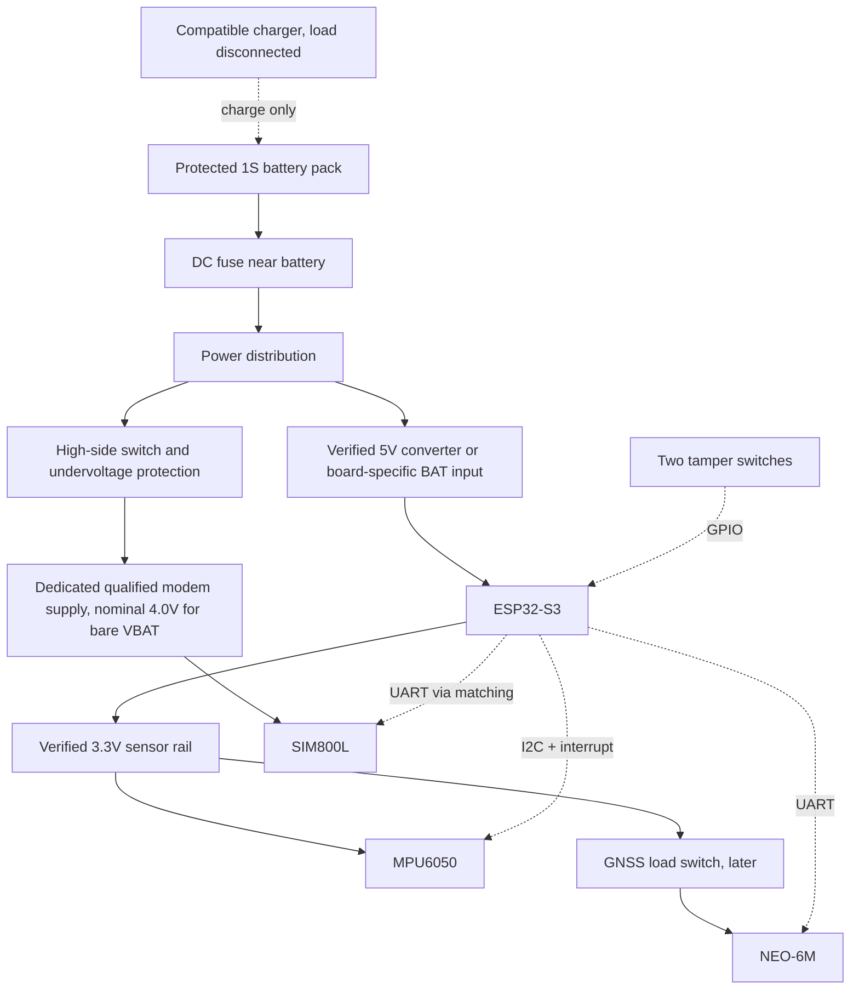
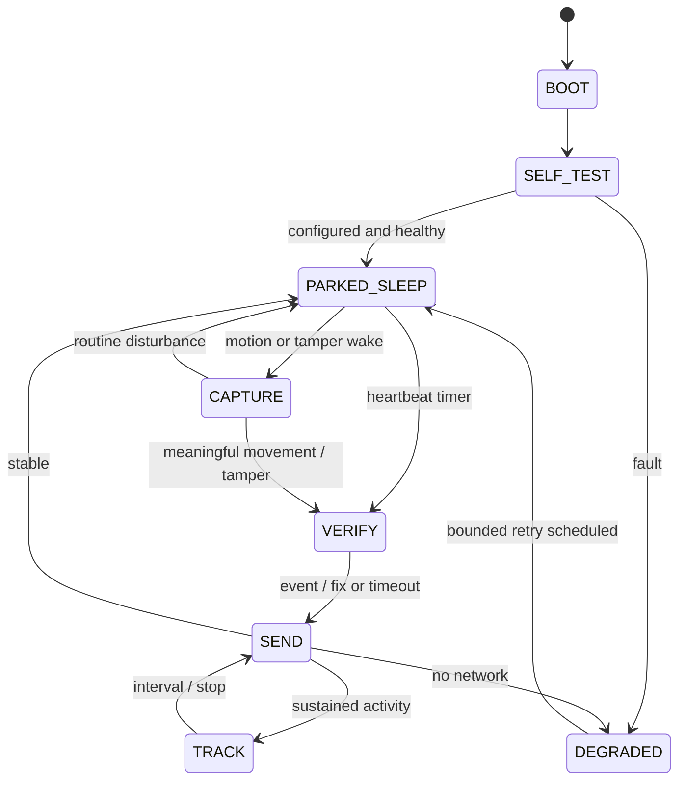

# VahakIN | Hardware, firmware and procurement specification

**Specification:** IG-HW-03 · Revision 2.2 · 25 November 2026  
**Status:** Current rapid prototype baseline, supersedes earlier proposed purchase lists  
**Related:** [Problem statement](problem%20statement.md) · [Architecture](architecture.md) · [Database](database.md) · [Implementation](implementation.md)

> The team already owns an ESP32-S3 development board, MPU6050 and SIM800L. Their exact board variants, pinouts, regulators and connector polarity have not been confirmed. No complete assembled unit has been electrically tested. The following is a procurement/engineering plan, not a final schematic or safety certification. Do not power uncertain wiring. Use a supervised bench supply and a multimeter first.

## 1. Design purpose

The device is intended to observe a vehicle during its authorised Non-Use period, detect significant movement or monitoring interference, acquire GPS positions, preserve events offline and deliver them securely to the central backend. It should be independent of the vehicle ignition and potentially its battery, with measured battery endurance. Current urgency favours using owned components for the demonstration, not purchasing duplicate premium modules. The initial system is not ready for unattended installation in a vehicle.

The original LoRa-only yard concept is superseded: distributed private vehicle locations require a communication path beyond one yard. Current SIM800L is a 2G prototype transport; ESP32 Wi-Fi is the dependable development fallback if secure GPRS is unavailable. Production baseline is a separately evaluated 4G Cat-1 GNSS design; no production endurance, cost or certification claim.

## 2. Bill of materials (one prototype)

Prices are indicative from prior eBhoot/Robokits planning, not a new quote or live stock reservation. Current budget excludes owned parts, SIM plan, shipping, tools and any additional high-current regulator. Do not purchase conditional power items until board variant and supply design are confirmed.

| # | Component / minimum specification | Qty | Status | Purpose | Est. INR |
|---|---|---:|---|---|---:|
| 1 | ESP32-S3 development board (exact SKU unknown) | 1 | Owned | Sensor processing, event queue, Wi-Fi, modem control, security | 0 |
| 2 | MPU6050 breakout (INT exposed preferred) | 1 | Owned | 3-axis acceleration + gyro; motion-triggered wake candidate | 0 |
| 3 | SIM800L breakout (exact input/logic variant unknown) | 1 | Owned | 2G GPRS/SMS test; conditional secure backend transport | 0 |
| 4 | NEO-6M GPS breakout with compatible antenna | 1 | Buy | Coordinates, speed, UTC, fix validity | 240 |
| 5 | Mechanical SPDT microswitch, low-current contact type | 2 | Buy | Case lid and mount release detection | 80 |
| 6 | Branded protected 1S Li-ion pack, nominal 3.7 V, ~5 Ah, ≥5 A pack discharge rating | 1 | Conditional | Independent supply; supplier confirms temperature/protection/current | 700 |
| 7 | MT3608 adjustable boost breakout | 1 | Conditional | 5 V branch for supported ESP32 board; never for bare SIM800L VBAT | 34 |
| 8 | TP4056 USB-C 1S charger module | 1 | Conditional | Bench charging of compatible pack while load disconnected | 15 |
| 9 | UART voltage translation components / TXS0108E evaluation board | 1 | Conditional | Match 2.8 V modem I/O to 3.3 V controller when required | 40 |
| 10 | GPIO-controlled high-side switch, ≥3 A, 1S compatible | 1 | Conditional | Hard power-off of modem after graceful shutdown | 150 |
| 11 | ABS enclosure, nominal IP65, sufficient dimensions | 1 | Buy | Mechanical protection, RF-friendly material | 200 |
| 12 | 830-point breadboard | 1 | Buy | Low-current signals only | 52 |
| 13 | Jumper set M-M/M-F/F-F | 1 set | Buy | Signal testing only | 120 |
| 14 | Capacitors, resistors, thermistor (see below) | 1 set | Buy | Decoupling, sensing, logic matching | 130 |
| 15 | FR4 perfboard | 1 | Buy | Soldered prototype | 60 |
| 16 | 22 AWG or suitable heavier power wire, keyed connectors | 1 set | Buy | Low resistance supply, connector fit/polarity | 100 |
| 17 | DC fuse/holder, heat shrink, standoffs, numbered seal, bracket | 1 set | Buy | Wiring protection and installation | 100 |
| 18 | Cellular antenna appropriate to owned module | 1 | If missing | Required RF interface; verify connector and bands | Quote |
| 19 | Compatible 2G-enabled SIM/data plan | 1 | Conditional | Test local GPRS coverage; Jio is not compatible with 2G-only module | Quote |
| 20 | Regulated ~4.0 V high-current modem supply / suitable buck-boost | 1 | Conditional | If raw battery branch cannot safely meet voltage across discharge | Quote |
| 21 | Multimeter; current-limited bench supply; oscilloscope | shared | Borrow/buy | Voltage, current, ripple and transient measurement | Lab / quote |

Planning subtotal for priced items: **₹2,021**. Carry ₹2,500–3,000 for the remaining parts if a suitable pack and supporting circuit are available; the necessary regulator/antenna, tools and service plan may raise the total. eBhoot: [website](https://ebhoot.com/), [NEO-6M](https://ebhoot.com/collections/gsm-gps-modules/products/neo-6m-gps-module), phone 9016649359 (previously retrieved contact; confirm ready stock). Robokits: [catalogue](https://robokits.co.in/), [custom battery pack service](https://robokits.co.in/batteries-chargers/customized-li-ion-battery-pack). Do not buy A9G, another SIM800L, another ESP32, another MPU6050 or LoRa for this baseline. NEO-M8N/M10 is optional upgrade only if verified board/antenna/logic support and budget permit.

Supporting components: 2 × 1000 µF 10 V low-ESR electrolytics, 2 × 100 µF low-ESR, 5 × 100 nF ceramic, 5 × 10 µF, 10 × 10 kΩ, 10 × 100 kΩ, 5 × 200 kΩ, 5 × 1 kΩ, 5 × 5.6 kΩ (UART network only if confirmed by modem reference circuit), 1 × 10 kΩ NTC, connector leads, strain relief and insulating materials. Exact values for final power circuit determined by schematic review and measurements; capacitors are not a substitute for adequate supply current.

## 3. Component inspection before connecting anything

Record photos of front/back, manufacturer, board model, pin labels, schematic or verified vendor documentation, input voltage, maximum input, logic levels, output rails, interrupt pins and connector polarity for every board. Distinguish chip datasheet limits from breakout-board limits. In particular:

| Item | Verify | Do not assume |
|---|---|---|
| ESP32-S3 | USB/5V/VIN/BAT label, onboard LDO, exposed RTC GPIO, UART, I2C, reserved pins | All S3 boards have same pinout, memory or battery charger |
| MPU6050 | Breakout regulator/dropout, I2C pull-up voltage, INT exposure, AD0 | All GY-521 boards work identically at 3.3/5 V |
| SIM800L | Bare VBAT vs 5 V-input carrier, PWRKEY behavior, antenna, UART logic and accessible reference supply | Red/blue PCB colour identifies voltage rating |
| NEO-6M | Supply range of actual breakout, UART logic, antenna connector, baud and NMEA output | 5 V supply/logic or genuine chip based on listing alone |
| Battery | Pack protection, max charge/discharge, chemistry, temperature, connector pinout | Capacity label guarantees quality or protection |
| Charger | 1S 4.2 V chemistry, charge-current setting, thermal design, protection/power-path arrangement | TP4056 is a load-sharing UPS or every board includes protection |
| Boost/switch | Input/output limits, output current at low VIN, idle current, reverse leakage, pin control, heat | Marketing 2 A rating is guaranteed at all voltages |

If any board lacks a trustworthy rating, defer connection until inspected by the university lab or supplier. Avoid installing in a real vehicle until pack thermal/safety and secure mounting are reviewed.

## 4. Power architecture and electrical compatibility

All signal circuits share ground. This is conceptual; the exact switching/regulation order depends on the selected components. Do not use a low-side switch that breaks ground while UART remains connected. Do not connect USB/external 5 V simultaneously if the board lacks safe isolation. Check connector polarity at the actual mating connector before power-on.

### 4.1 Modem supply (critical)

SIM800L chip hardware design specifies nominal recommended 4.0 V, operating range 3.4–4.4 V and transmit peaks around 2 A. A breakout may include a different rated input regulator. Never connect 5 V to bare VBAT. A protected 1S cell reaches 4.2 V at full charge but may drop below the module operating range under load, so direct battery supply is conditional on actual VBAT variant, pack discharge characteristics, low-resistance wiring, switch drop and cutoff. Set conservative modem cutoff before loaded voltage falls below the allowed minimum; validate margin with an oscilloscope. Prefer a verified regulated 4.0 V supply that can deliver 2 A bursts across cell discharge and startup; a 3 A-capable design gives headroom but must be tested at minimum input and temperature. If not available, use lab supply for initial modem tests; do not improvise an unsafe field battery circuit.

Place manufacturer-recommended low-ESR bypass close to modem VBAT/GND; add suitable bulk capacitance if measurements justify it. Keep leads short and thick, avoid breadboard rails/dupont for power. Select a fuse rated for wire, pack and measured inrush; do not blindly assume 3 A is correct. Use antenna before transmitting. Confirm supply remains in specification during registration and repeated data transmissions.

### 4.2 Controller/sensor rail and charger

For a documented 5 V input board, set MT3608 to 5.0 V using meter before connection; check ripple and loaded output at minimum pack voltage. A board with dedicated compatible single-cell battery input may not need a 5 V boost. Never feed 5 V into a 3.3 V pin. Supply GPS/MPU6050 only at verified breakout voltage; 3.3 V logic must not see 5 V pull-ups. Check the controller regulator can supply both sensors and the controller peaks, or add an appropriate regulator. MT3608 is a prototype converter, not assumed to be ultra-low-Iq or sufficient for modem supply.

TP4056 is a linear 1S charger; use a properly protected pack with documented charge limits and correct current setting, disconnect system load while charging, and do not charge in unsuitable heat or an enclosed hot vehicle. A nominal 5 Ah pack does not prove a particular charge current is safe. Use a compatible charger with temperature management where required. No charging from vehicle electrical system in MVP; future automotive input requires transient, reverse polarity, fuse and regulatory design.

### 4.3 UART and GPIO compatibility

Bare SIM800L interface is typically 2.8 V logic; verify hardware design for voltage matching. ESP32 is 3.3 V logic. Use validated dedicated directional translator or vendor recommended resistor/transistor circuit; TXS0108E is only a candidate if rail references and loading match. Do not use its lower rail at 5 V; do not assume a valid 2.8 V reference is exposed. Avoid phantom power via UART and GPS TX when modules are switched off; use appropriate high-impedance state and/or isolation. I2C pull-ups must be in correct domain. Switches use dry contacts to GPIO/GND with suitable pull-up/down; no external 5 V signal. Confirm required wake polarity, debounce, and line-break detection strategy. Mechanical switch cannot prove no bypass.

## 5. Logical pin/interface plan (not physical pin numbers)

Assign after exact ESP32-S3 board photo and schematic review. Avoid boot-strapping, USB/JTAG and flash/PSRAM reserved pins. Use RTC-capable exposed GPIO for deep-sleep wake (check ESP-IDF and board). The final `board_config.h` must list actual pin numbers and reserved conflicts.

| Logical name | Direction | Required property |
|---|---|---|
| `IMU_SDA`, `IMU_SCL` | I2C | 3.3 V compatible, pull-ups verified |
| `IMU_INT` | input | RTC-capable, interrupt polarity/latching |
| `GNSS_RX`, `GNSS_TX` | UART | Dedicated hardware UART; TX/RX crossed, common GND |
| `MODEM_RX`, `MODEM_TX` | UART | Separate hardware UART, voltage matching |
| `CASE_TAMPER`, `MOUNT_TAMPER` | inputs | RTC-capable if deep sleep wake required |
| `MODEM_EN`, `MODEM_PWRKEY` | outputs | Correct switch/PWRKEY voltage and timing; safe boot defaults |
| `GNSS_EN` | output | Load switch enable later, safe boot default |
| `BAT_ADC` | analog input | Calibrated divider, max pin voltage safe over full charge |
| `TEMP_ADC` | analog input | Optional calibrated thermistor circuit |
| `DEBUG_UART/USB` | debug | Keep separate from modem/GNSS where possible |

Use firmware pin mapping tests before enabling sleep. An exact pin list cannot be safely guaranteed without knowing owned board models. Test all wake inputs individually and simultaneous wake. ESP32-S3 EXT1 wake supports suitable RTC pins; select wake modes appropriate to common signal polarity, and account for level-held interrupt causing immediate re-wake.

## 6. Sensors and evidence quality

### 6.1 NEO-6M

Older GPS receiver sufficient for open-sky demo if genuine and functioning. Obtain NMEA RMC/GGA or suitable binary messages; extract fix status, UTC, position, speed, satellites and HDOP. Use speed in m/s in protocol; convert to km/h only in UI. Never substitute `0,0` for unavailable fix. No promise of indoor fix or modern multi-GNSS accuracy. If motion occurs, send event first with prior location labelled stale if available; a later position update links by event/journey. Timeout acquisition and record failure rather than keep GPS on indefinitely.

### 6.2 MPU6050

Read six-axis data over I2C, confirm WHO_AM_I and address (often 0x68 or 0x69 depending AD0). Validate orientation, offset, sensor saturation and sample timestamps. Low-power accelerometer monitoring and wake interrupt are candidates; continuous six-axis operation consumes substantially more. Disable gyro in standby if supported, enable for short active windows. Measure full breakout including LED/regulator. Start with threshold + duration + GPS corroboration, not an untrained model. Movement does not identify the driver or prove commercial operation.

For research, collect labelled 2–5 s windows around 50–100 Hz during authorised test sessions; preserve vehicle/session IDs, mounting orientation, sensor range, timestamps and labels. Split by vehicle/session to avoid leakage. Features may include gravity-compensated RMS, variance, peaks, duration, tilt/gyro change and frequency bands. Compare rules, decision tree, small Random Forest; report class recall, precision and false alarms per stationary vehicle-day. Export only a measured model that fits memory/latency. Keep an `unknown` class and version features/model. Do not claim reliable distinction of towing vs driving unless validated.

### 6.3 Tamper and battery monitoring

One switch opens/releases when case lid is opened; other releases when enclosure leaves vehicle mount. Test both armed states and wire disconnection; use appropriate polarity and debounce (e.g. 30–100 ms test setting). Numbered seal, authorised installation photo/reference and bracket add physical evidence. Device removal can invalidate the relationship between GPS device and vehicle position until reverified. Use battery ADC divider with calibrated actual ADC attenuation/range; switch divider if practical to reduce drain. Voltage-derived charge percentage is an estimate influenced by load and temperature; use null if not calibrated. NTC provides temperature observation only after calibration; not substitute for hardware thermal protection.

## 7. Firmware design and protocol

Use ESP-IDF (or Arduino for initial proof then consistent production toolchain), build with pinned version and exact board target. Modules: `board`, `power`, `imu`, `gnss`, `modem`, `tamper`, `clock`, `event_builder`, `queue`, `transport`, `security`, `config`, `scheduler`, `diagnostics`, `ota` (later). Interface adapters keep Wi-Fi and modem interchangeable. Shared JSON contract in [Architecture](architecture.md). Do not embed Supabase service key or real device secret in repo. Per-device credentials are provisioned and stored securely; rotate upon reassignment.

Persist event immediately on detection, independently of fresh GNSS fix. Wake from timer, IMU or switch. Sample short motion window, classify, acquire location if indicated and feasible, attempt connection, sign batch, send, await durable ACK, delete only acknowledged queue records, gracefully power down peripherals. Track active movement with adaptive intervals until stop, then record final position and sleep. Heartbeat contains actual last fix, battery/signal status and firmware/config versions. Deep sleep loses volatile RAM; persistent queue and stable event IDs survive reset. Use watchdog, reason codes for reset/fault, and safe configuration defaults.

### 7.1 Reporting policy defaults (proposal)

| Condition | Initial demo config | Future mostly stationary config |
|---|---|---|
| Heartbeat | 15–30 s during live demo | 6 h initial evaluation, RTO configurable |
| IMU | Continuous active for bring-up | Low-power motion interrupt; burst sample |
| Moving GPS | 5–10 s if working | 10–30 s, configurable |
| Moving transmit | 10–30 s | 30–60 s, configurable |
| Tamper | Immediate attempt | Immediate attempt; queue offline |
| No GPS | Bounded acquisition timeout | Report uncertainty and retry as scheduled |
| No network | Bounded retry, then backoff | Exponential capped retry with jitter |

Demo mode is visibly labelled and consumes more battery. Do not use demo intervals for endurance promises. Configure next heartbeat and grace; commands only delivered during connection, not instantly when sleeping. Store versioned config, reject stale/expired commands, ACK applied or failed. OTA later requires signed firmware, dual slots if flash allows, verified TLS, battery threshold and rollback.

### 7.2 Offline queue

Use durable bounded flash queue with CRC/hash and stable event UUID, boot ID and sequence. Record original observation time/clock quality or uptime if time unknown. Write with atomic commit/recovery and wear awareness. Prioritise tamper, movement and queue-overflow notices; do not silently overwrite high-priority data. Report count/type of discarded lower-priority events if space exhausted. Partition after inspecting actual flash size and compiled image; do not assume owned S3 has 8 MB flash/PSRAM. PSRAM is volatile and not an offline archive. Batch ≤50 events/64 KiB, retry with same event IDs and new signed request, no removal before durable ACK. Preserve assignment association; before reuse drain or quarantine previous queue, then securely reset/rotate credentials.

## 8. Battery calculation and measurement

No battery-life guarantee. Measure battery-side current (including converter efficiency, LEDs, GNSS, modem, sensor, leakage and switch pull currents). Approximate daily charge consumption:

`Q_day = I_sleep × (24 - t_active_hours) + I_active × t_active_hours + Q_extra_events + Q_retries`.

`life_days ≈ capacity_mAh × usable_fraction / Q_day`.

Example only: 5,000 mAh pack, assumed 80% usable, 4 reports/day × 90 s = 0.1 h active; average battery-side active current 250 mA. At 0.2 mA standby, daily ≈29.78 mAh and ≈134 days. At 5 mA standby, ≈144.5 mAh/day and ≈27.7 days. Neither is a measured result, and usable capacity depends on cutoff/temperature/load. This demonstrates why generic dev boards and boost converter may miss month-scale goals. Measure standby, GPS fix, attach, send, weak network retries, tracking, temperature and actual charge delivered. Report range and assumptions. For production consider low-Iq custom PCB, low-power accelerometer and qualified battery.

## 9. Communication and security limits

SIM800L is 2G GSM/GPRS; verify compatible operator, SIM plan, signal, APN, registration, TCP/data, and ability to establish modern secure transport with certificate validation before use. A supported TLS path could be through validated ESP32-managed secure transport if modem supports appropriate data link, subject to testing. Do not assume built-in HTTP commands support modern HTTPS. If not feasible, use ESP32 Wi-Fi + mobile hotspot for the SFIC demo and label dependence clearly. Never send real owner/location telemetry over unencrypted HTTP. 4G with GNSS (e.g. exact GNSS-enabled A7672S variant) is a production candidate requiring different power/interface design and certification checks. No 4G purchase required for current demo if Wi-Fi works.

## 10. Bring-up and acceptance gates

| Gate | Test | Pass evidence |
|---|---|---|
| H0 | Photograph/document boards and inspect battery | Verified pinout, voltage, connector, protection and charger |
| H1 | Controller on USB only | Stable serial logs, exact flash/PSRAM identified |
| H2 | MPU6050 alone | Correct ID, axis response, interrupt and repeatable samples |
| H3 | GNSS alone outdoors | Valid fix/time/speed, invalid fix handled |
| H4 | Tamper inputs | Two distinct debounced events, cable break test, sleep wake if configured |
| H5 | Wi-Fi ingestion | Authenticated actual event and durable ACK shown in website |
| H6 | SIM800L on lab supply | 2G attach/data, voltage transient measured within rating, secure transport verified or documented fallback |
| H7 | Battery branch | Loaded voltage, current, cutoff, temperature and charging procedure verified by lab |
| H8 | Combined assembly | No modem brownouts, correct common ground, no phantom power, enclosure fit |
| H9 | Offline recovery | Network cut, queued events, reboot recovery, no duplicate events on reconnect |
| H10 | Deep sleep | Repeatable timer/motion/tamper wake, measured standby, no wake loop |
| H11 | Controlled movement | Real GPS departure/return, normal bump, loss of fix, case/mount tamper |
| H12 | Pilot gate | Authorised installation, environmental and regulatory review; no field deployment until approved |

## 11. Production optimisation and references

Future cost optimisation: reuse existing authorised trackers where possible; integrate 4G/GNSS and low-power sensing on a custom PCB, source certified packs in bulk, minimise enclosure size and standby current. Target ₹1,500–2,000 hardware is an unverified engineering aspiration, not a quotation. AIS-140 applicability and any other certification, environmental and radio requirements need regulator/qualified engineer review. Do not market prototype as compliant or vehicle-grade.

Reference material (consult exact board docs, not only bare chips):
- [Espressif ESP32-S3 sleep modes](https://docs.espressif.com/projects/esp-idf/en/stable/esp32s3/api-reference/system/sleep_modes.html).
- [SIMCom SIM800L Hardware Design, power supply (manufacturer manual mirror)](https://www.manualslib.com/manual/1747481/Simcom-Sim800l.html?page=20); confirm applicable revision for owned carrier.
- [u-blox NEO-6 product family](https://www.u-blox.com/en/product/neo-6-series?page=1).
- [TDK MPU6050 product specification (datasheet mirror)](https://partsplanai.com/datasheet/a4fdf69590b8cbab1cf0a5bcd359327b0ac022061fb233855aff2e191e7e3584/tdk-invensense-mpu-6050).
- Earlier XIAO/A7672S procurement PDFs are superseded for current owned-component prototype. Do not mix wiring from incompatible versions.
